# Black Clover: Grimoire Awakening

> **Early Access – v0.6.0.** [Download the latest release](https://github.com/priyanshchan/black-Clover-anime-addon-for-minecraft-bedrock-edition/releases) · [Documentation](docs/README.md) · [Changelog](CHANGELOG.md) · Found a bug or a balance problem? Please [open an issue](https://github.com/priyanshchan/black-Clover-anime-addon-for-minecraft-bedrock-edition/issues/new/choose).

**An unofficial Black Clover fan addon for Minecraft Bedrock Edition** – receive your own grimoire, master one of 36 magic attributes, lead a squad of Magic Knight companions with their own personalities and specialisations, draw anti-magic demon swords, wear squad robes, fly brooms, and fight devils, pirates, rogue mages and a dozen giant bosses.

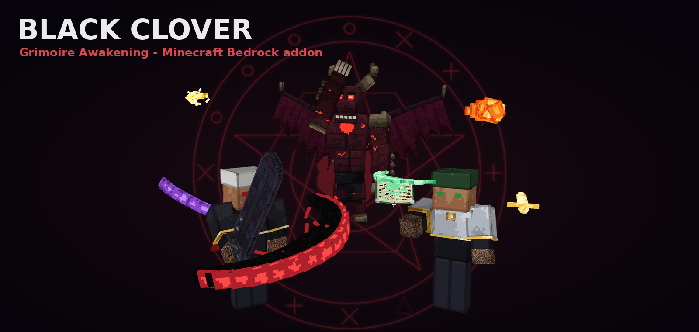

Every model, texture, particle, sound and icon in this pack is original and generated from source code in [`tools/`](tools/) – no art or audio from the anime is used.

> Unofficial fan-made content. Not affiliated with or endorsed by Yūki Tabata, Shueisha, Studio Pierrot or Mojang/Microsoft.

---

## Features

* **36 grimoires, 215 spells** (six per grimoire: levels 1, 3, 6, 10, 12 and an awakened spell at 15) – Wind, Flame, Water, Lightning, Ice, Earth, Steel, Sand, Bubble, Plant, Poison, Blood, Sound, Mist, Crystal, Bone, Magma, Cotton, Paper, Smoke, Glass, Beast, Thorn, Ash, the rarer Light, Dark, Spatial, Mirror, Star, Time, Gold, Spirit, Rune, Gravity and Moon (four-leaf), and the very rare five-leaf **Anti-Magic** grimoire.
* **3D held grimoires** – your grimoire floats open beside your shoulder with flipping pages, glowing rune text and a spinning magic sigil (first-person view included).
* **3D anti-magic swords** – Demon-Slayer, Demon-Dweller and Demon-Destroyer, each with its own ability, spell-cutting and an Anti-Magic gauge that powers **Black Form**.
* **3D spell entities with animations** – wind crescents, fireballs, a roaring flame lion, a serpentine water dragon, a spinning tornado, thunder spears, swords of light, dark crescents, a black hole, ice spears and ice prisons.
* **62 custom particle effects** – magic circles that face your cast direction, ground circles, element trails, shockwaves, lightning strikes, black anti-magic crackle, clover leaves, snowstorms and more.
* **34 custom sound effects** synthesised for the addon (cast shimmer, page flips, anti-magic slashes, Black Form roar, level-up chime, Devil roar…).
* **Mana, levels and progression** – mana bar HUD made from custom font glyphs, magic XP, 20 levels, new spells at levels 3 / 6 / 10.
* **The Grimoire Altar** – a 3D block with a ceremony that chooses your attribute.
* **Magic Knight robes** – Black Bull, Golden Dawn and Crimson Lion capes (3D, animated cape) with set perks.
* **Enemies** – Dark Disciples (hooded mages that cast dark bolts and blink behind you) and the **Devil** boss (420 HP, two phases, boss bar, dark lightning, summons, roar, orb barrages).
* **Magic Knight's Handbook** – in-game menu for your stats, spell selection, every attribute's spell list and a guide.
* Player cast / slash / guard animations, camera shake, titles.
* **v0.6.0 – a grimoire and a fruit:** every companion fights with a grimoire **and** an Abyss Fruit (feed them any fruit to change it), and every grimoire and fruit gains a new move - 35 level-12 spells, Black Hurricane for Anti-Magic, and a fourth power for all 30 fruits (awakens at Will 2): 215 spells and 120 fruit powers in all.
* **v0.5.0 – the companion update:** personalities, specialisations (Vanguard, Arcanist, Warden, Ranger) with mastery, party tactics, combos and marks, danger-aware positioning, revives, mood, camps with a night watch, talking, personal trials, a reserve of 6 more knights with real-time expeditions, a Training Dummy, sparring and rival squads, companions flying brooms with you; 4 new grimoires (Gravity, Moon, Thorn, Ash) and the **Soul Puppeteer**, a boss that takes control of your companions.
* **v0.3.0 – sky, missions & new foes:** magic **brooms** you fly on your own mana, **daily missions** and the Mission Board, five **amulets** for your off hand, **31 awakened spells** at level 15, **Rogue Mages** (outlaws with real grimoires) and rogue ambushes, the **Witch Sisters** twin boss and the **Bone Dragon**, and **Magic Knight camps**.
* **v0.2.0 – companions & smarter foes:** a saved party of up to 4 knight companions (levels to 20, bonds, orders, stances, formations, gifts, robes, Union Magic) with a smart support AI; tactical enemies (gunners, marksmen, pack-hunting Hellhounds, Mana Wraiths); bosses with threat tables, three phases, telegraphs and desperation moves; the Fallen Captain; 8 more grimoires and 8 more fruits (Lion, Shark, Phoenix and Spider forms); many new animations.
* **v0.1.0 – AI & simulation:** a tactical brain for spellcasting NPCs (spell choice by situation, aim leading, dodging, focus fire, healing allies, retreating), battle tactics, formations, morale and routs, leaders, three-army battles and knight duels with a live scoreboard, kill feed, battle reports and a cinematic camera, and a world simulation where the four factions gain and lose power, fight off screen and launch offensives.
* **Wave 4 – a living world:** a data-driven spell engine, 12 more grimoires and 12 more Abyss Fruits (Bear, Tiger and Wyvern beast forms), four giant bosses (Archdevil, Stone Colossus, Phantom Galleon, Storm Kraken), random world events, roaming Magic Knight NPCs, factions that fight each other, a travelling merchant, and the **War Table** battle simulator.
* **Wave 3:** Spatial, Earth, Steel and Mirror magic, all nine squad robes, Magic Knight ranks, Mana Skin and Mana Zone, ancient dungeons with traps and a Guardian, Imps, four more Abyss Fruits (including Wolf and Hawk beast forms), a bounty on your head and the Tidewatch navy, treasure maps, cutlass, flintlock and grappling harpoon.
* **Expansion – The Abyssal Seas:** 6 Abyss Fruits with 18 abilities, the Will system, steerable sailing ships with cannons, Sea Raiders and fruit-wielding Raider Captains, generated outposts and shipwrecks, a Bounty Board with a doubloon shop, and the Abyssal Leviathan boss.

| Spells | Grimoires & swords |
|---|---|
| 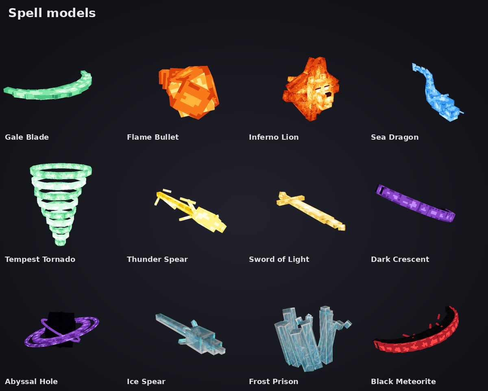 |  |

| Enemies | Robes |
|---|---|
| 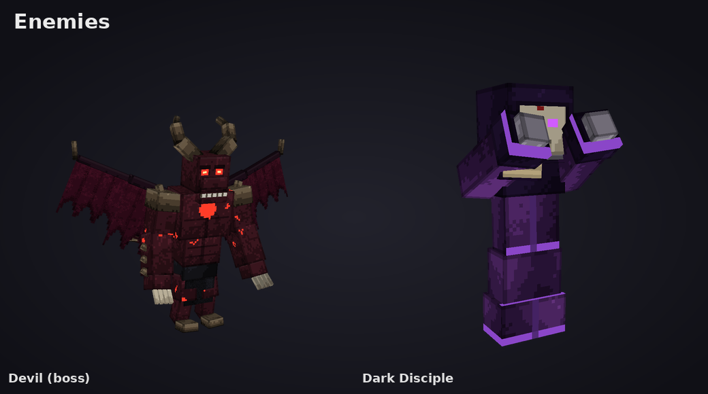 | 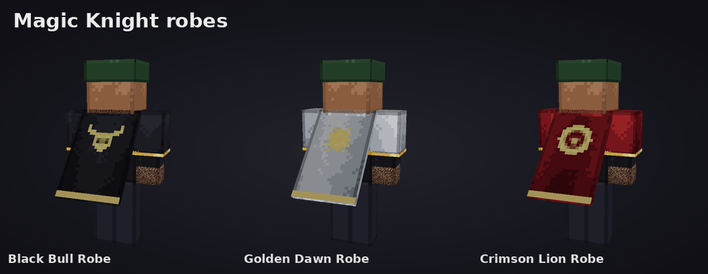 |


---

## Documentation

Every detail lives in **[docs/](docs/README.md)** (generated from the game data, so the numbers always match the build):

| Page | |
|---|---|
| [Getting started](docs/getting-started.md) | install, your first hour, where to go next |
| [Magic](docs/magic.md) | all 32 attributes with altar odds, all 128 spells with numbers, anti-magic, techniques |
| [Abyss Fruits](docs/fruits.md) | all 30 fruits and 90 abilities with numbers, the rules, Will |
| [Companions](docs/companions.md) | your saved party: recruiting, the whistle, orders, stances, formations, bond and its perks, robes, levels to 20 |
| [AI & simulation](docs/ai-and-simulation.md) | how NPCs, enemies and bosses think, battles (tactics, morale, leaders, bets, camera), the world simulation |
| [World events](docs/world-events.md) | every event, its odds, conditions and rewards |
| [Mobs & bosses](docs/mobs-and-bosses.md) | every creature's health, attack, spawning and drops; all 8 bosses; factions; structures |
| [Items & recipes](docs/items-and-recipes.md) | every crafting recipe, every item id, both shops |
| [Progression](docs/progression.md) | magic levels and mana, ranks and stars, robes, bounties |
| [Commands](docs/commands.md) | every `/give`, `/summon` and `/scriptevent` |
| [FAQ](docs/faq.md) | install problems, multiplayer, turning events off, known issues |
| [Development](docs/development.md) | building, code map, adding spells, releasing ([contributing](CONTRIBUTING.md)) |

## Install

1. Download **`BlackClover_GrimoireAwakening_v0.1.0.mcaddon`** from the **[Releases page](https://github.com/priyanshchan/black-Clover-anime-addon-for-minecraft-bedrock-edition/releases)** and open it – Minecraft imports both packs.
   (Separate `.mcpack` files for the behavior and resource packs are attached too, and the latest build is always in [`dist/`](dist/).)
2. Create or edit a world → **Behavior Packs** → activate *Black Clover: Grimoire Awakening* (the resource pack is added automatically).
3. Requires **Minecraft Bedrock 1.21.90 or newer**. No experimental toggles are needed – the scripts only use the stable `@minecraft/server` 2.0.0 and `@minecraft/server-ui` 2.0.0 APIs.

## How to play

1. On your first spawn you receive a **Grimoire Altar** and the **Magic Knight's Handbook**.
2. Place the altar and **interact** with it. After a short ceremony a grimoire chooses you
   (32 attributes; [odds](docs/magic.md#attributes-and-altar-odds)).
3. Hold your grimoire:
   * **Use** (right-click / tap & hold) – cast the selected spell.
   * **Sneak + Use** – flip to the next unlocked spell (or pick one in the Handbook).
4. The HUD above the hotbar shows the selected spell, its cooldown, your mana bar and level.
5. Casting and defeating monsters gives magic XP. Spells unlock at **levels 1, 3, 6 and 10**; spell power grows with every level (max 20).
6. Lost your grimoire? Interact with any Grimoire Altar to get it back. Want a different attribute? Use a **Wishing Clover Charm**.

### Anti-Magic

A five-leaf grimoire holds no spells – its pages hold demon swords. "Cast" a page to draw that sword.

| Sword | Use ability | Notes |
|---|---|---|
| Demon-Slayer Sword | **Black Meteorite** – a piercing anti-magic slash wave that also cuts enemy spells out of the air | 12 attack damage |
| Demon-Dweller Sword | **Spell Return** – swallows every hostile spell/projectile within 8 blocks and fires them back as anti-magic slashes (a flash-slash dash if nothing is nearby) | fast blade |
| Demon-Destroyer Sword | **Curse-Breaker Thrust** – dash that strips every effect from enemies it hits and cleanses your own debuffs | 10 attack damage |

* Sword hits fill the **Anti-Magic gauge** (also filled by taking hits and killing magical enemies). At 100% cast **Black Form** for 30 s of strength, speed, resistance, black lightning aura and stronger sword abilities.
* **Sneak** while holding a demon sword to automatically cut down incoming spells and projectiles.
* Demon swords deal bonus damage to magical enemies (Dark Disciples, the Devil) and strip their buffs.

### Spells

| Attribute | Spell | Lv | Mana | Cooldown | Effect |
|---|---|---|---|---|---|
| **Wind** (Three-leaf) | Gale Blades | 1 | 14 | 0.8s | Fires a fan of three cutting wind crescents. |
|  | Cyclone Step | 3 | 18 | 3s | Dash forward on a gust, flinging foes aside. |
|  | Tempest Tornado | 6 | 40 | 8s | A roaming tornado that drags enemies skyward. |
|  | Storm Ascension | 10 | 70 | 20s | Erupt into the sky with a devastating wind burst. |
| **Flame** (Three-leaf) | Flame Bullet | 1 | 12 | 0.7s | A searing fireball that ignites on impact. |
|  | Blazing Pillar | 3 | 24 | 4s | Pillars of fire erupt where you look. |
|  | Inferno Lion | 6 | 45 | 9s | A roaring lion of flame that explodes on impact. |
|  | Solar Nova | 10 | 75 | 22s | An expanding ring of solar fire around you. |
| **Water** (Three-leaf) | Water Bullet | 1 | 10 | 0.5s | Rapid pressurised water orbs. |
|  | Healing Spring | 3 | 30 | 10s | Restores health to you and nearby allies. |
|  | Sea Dragon Roar | 6 | 45 | 9s | A water dragon that pierces through every enemy. |
|  | Tidal Prison | 10 | 70 | 22s | Traps all nearby enemies in crushing water bubbles. |
| **Lightning** (Three-leaf) | Thunder Spear | 1 | 14 | 0.8s | A lightning spear that chains between foes. |
|  | Flash Step | 3 | 16 | 2.5s | Blink forward in a flash, shocking anything in the path. |
|  | Thunder Fiend Armor | 6 | 40 | 25s | Clad yourself in lightning: speed, haste and shock strikes. |
|  | Heaven's Judgment | 10 | 80 | 24s | Call down a storm of judgment bolts on all foes. |
| **Light** (Four-leaf) | Swords of Light | 1 | 22 | 1.5s | Summon blades of light that hunt your target. |
|  | Light Speed | 3 | 20 | 3s | Move at the speed of light. |
|  | Holy Ray | 6 | 40 | 7s | A piercing beam of pure light. |
|  | Radiant Rain | 10 | 85 | 25s | A rain of light swords over the battlefield. |
| **Dark** (Four-leaf) | Dark Crescent | 1 | 18 | 1.2s | A cloaked crescent slash that pierces through foes. |
|  | Abyssal Hole | 3 | 38 | 9s | A black hole that devours enemies and magic. |
|  | Shadow Cloak | 6 | 30 | 20s | Vanish into darkness and strike unseen. |
|  | Dimension Rift Slash | 10 | 90 | 26s | A slash that cuts through space itself. |
| **Ice** (Three-leaf) | Ice Spear | 1 | 12 | 0.7s | A crystal spear that chills its target. |
|  | Frost Prison | 3 | 30 | 8s | Encase enemies around your target in ice. |
|  | Glacier Wall | 6 | 26 | 10s | Raise a temporary wall of glacial ice. |
|  | Absolute Zero | 10 | 80 | 24s | A blizzard that freezes everything around you. |
| **Anti-Magic** (Five-leaf) | Demon-Slayer Sword | 1 | - | 2s | Draw the massive Demon-Slayer Sword from your grimoire. |
|  | Demon-Dweller Sword | 3 | - | 2s | Draw the Demon-Dweller Sword, which returns spells. |
|  | Demon-Destroyer Sword | 6 | - | 2s | Draw the Demon-Destroyer Sword, which breaks curses. |
|  | Black Form | 10 | gauge 100% | 45s | Unleash the devil within. Requires a full Anti-Magic gauge. |

### Magic Knight robes (chest slot)

| Robe | Recipe | Perk |
|---|---|---|
| Black Bull Robe | black wool ×7, gold nugget, mana crystal | +25% mana regen, +25% spell power below 40% HP |
| Golden Dawn Robe | white wool ×7, gold ingot, mana crystal | +40 max mana, +10% spell power |
| Crimson Lion Robe | red wool ×7, blaze powder, mana crystal | Flame spells cost 15% less and hit 15% harder |

All robes give 6 armor points, can be enchanted and repaired with mana crystals.

### Items & crafting

| Item | Recipe | Use |
|---|---|---|
| Mana Crystal ×2 | amethyst shard + lapis lazuli + glowstone dust (shapeless) | restores 45 mana (or +20% anti-magic gauge) |
| Grimoire Altar | `MBM / GLG / SSS` – M mana crystal, B book, G gold ingot, L lectern, S stone bricks | receive / recover your grimoire |
| Magic Knight's Handbook | book + mana crystal | stats, spell picker, guide |
| Devil Summoning Contract | `CMC / MBM / CMC` – C crying obsidian, M mana crystal, B book | summons the Devil boss where you look |
| Wishing Clover Charm | `EME / MHM / EME` – E emerald, M mana crystal, H Devil Heart | give up your grimoire and roll a new one |

### Enemies

* **Dark Disciple** – spawns on the surface at night. Casts dark bolts (weakness), blinks behind attackers when hurt. Drops mana crystals.
* **Devil** – summoned with a contract. Hovers and circles you, claws at close range and uses dark lightning, a darkness roar, orb barrages and summons Disciples. Below 50% HP it enters a faster, angrier second phase. Drops the **Devil Heart**, mana crystals and diamonds.

### Commands (creative / testing)

```
/give @s bc:grimoire_wind        (any attribute: wind flame water lightning light dark ice anti)
/give @s bc:demon_slayer_sword
/give @s bc:grimoire_altar
/summon bc:devil
/summon bc:dark_disciple
```

Players in **creative mode** can use any grimoire with every spell unlocked and infinite mana.

---

## Expansion: The Abyssal Seas

A Black Clover-meets-pirate-adventure expansion with **all-original** content: Abyss Fruits, Will, sailing ships, raiders, bounties and a sea boss. It works alongside grimoires: a mage can also eat a fruit.

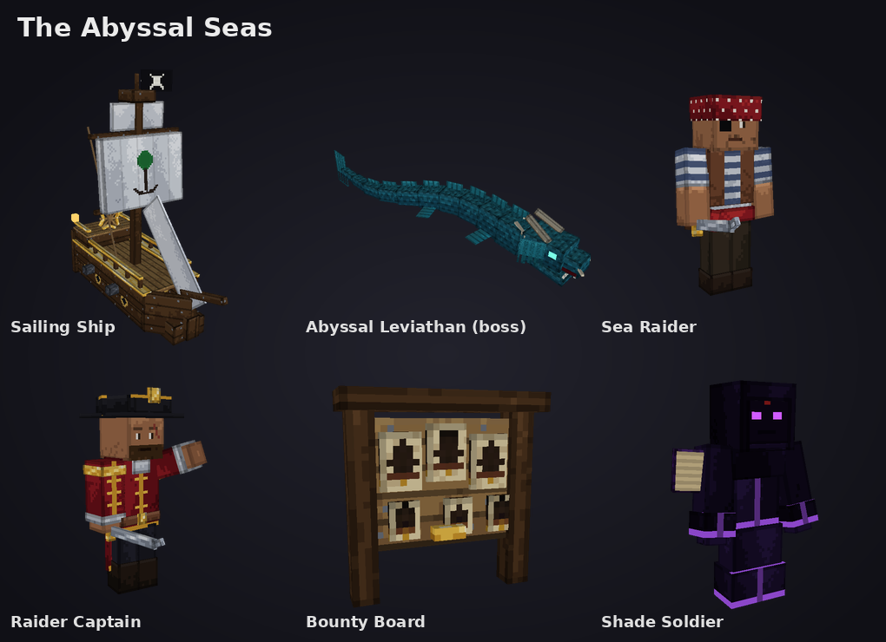

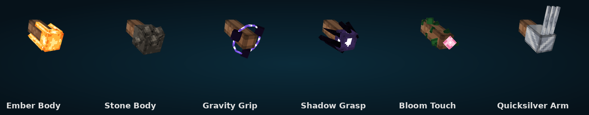

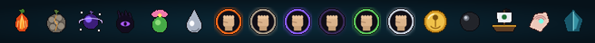

### Abyss Fruits

Eat a fruit (hold Use) to gain its power permanently, plus a bound power item that shows an aura on your casting arm. **You can only ever hold one fruit**: eating a second one hurts you badly. Fruit users are drained in deep water (powers off, slowed, slowly sinking), and **anti-magic seals fruit powers** for a few seconds (demon-sword hits, Black Meteorite slashes). Your fruit power returns to you after death.

| Fruit | Passive | Abilities (Use = cast, Sneak + Use = switch) |
|---|---|---|
| **Ember Fruit** | Immune to fire. Your punches set foes ablaze. | **Ember Fist** (1.6s) – Hurl a fist of fire that bursts on impact.<br>**Blaze Step** (4s) – Dash forward, leaving a trail of fire.<br>**Cinder Nova** (14s) – Detonate in a ring of white-hot flame. |
| **Stone Fruit** | Hardened skin: you take less damage and shrug off knockback. | **Boulder Fist** (2s) – Launch a boulder that shatters on impact.<br>**Earth Spikes** (5s) – Stone spikes erupt in a line ahead of you.<br>**Fortress Skin** (20s) – Turn to granite: huge resistance, slower steps. |
| **Gravity Fruit** | You never take fall damage. | **Gravity Crush** (4s) – Slam everything near your aim into the ground.<br>**Repulse** (6s) – Hurl everything around you away.<br>**Falling Star** (18s) – Pull a burning meteor down onto your aim. |
| **Shadow Fruit** | Night vision, and you vanish while sneaking in the dark. | **Shadow Bind** (6s) – Shadows pin down every enemy near your aim.<br>**Shade Step** (3s) – Step through the shadows behind your target.<br>**Umbral Legion** (30s) – Raise three shade soldiers to fight for you. |
| **Bloom Fruit** | You slowly regenerate while standing on grass or leaves. | **Thorn Lash** (1.8s) – A whip of poisoned thorns lashes ahead.<br>**Healing Pollen** (12s) – Pollen heals you and nearby allies.<br>**Rooting Grove** (18s) – Roots seize and crush every enemy around you. |
| **Quicksilver Fruit** | Liquid-metal body: arrows and blades glance off you more often. | **Mercury Blades** (2.2s) – Fling a fan of liquid-metal blades.<br>**Flow Dash** (4s) – Pour yourself forward through every enemy.<br>**Silver Storm** (16s) – A storm of spinning blades surrounds you. |

Fruits come from Raider Captains (35% drop), sunken-wreck chests, the Leviathan (guaranteed) and the Bounty Board shop.

### Will

Everyone has Will, an original fighting-spirit stat trained by fighting (melee hits, taking hits, kills, bounties, Leviathan Scales). Will levels go to 10; the gauge refills over time.

| Will level | Unlock |
|---|---|
| 1 | **Iron Will** – melee hits spend Will for bonus damage |
| 3 | **Keen Will** – a chance to sidestep blows and arrows (the damage is undone) |
| 8 | **Sovereign Will** – **Sneak + Jump** at full Will: a pulse that floors weak enemies and staggers the rest |

### Ships

* **Sailing Ship** – craft ` W / PIP / PPP ` (white wool, oak planks, iron ingot) and use it on water. Up to 4 people aboard; the first is the captain.
* **Steering:** look where you want to sail and hold forward; hold back to brake. The sails fill out as you speed up.
* **Cannons:** use **Cannonballs** (iron ingot + gunpowder → 4) while aboard to fire. Cannonballs damage mobs and other ships.

### Raiders, outposts & wrecks

While you sail over deep water, **pirate outpost islands** (palms, tent, dock, campfire, loot chest, a Bounty Board) and **sunken wrecks** (two treasure chests, Drowned) appear out of sight. **Sea Raiders** also spawn on beaches at night. **Raider Captains** have generated names and each wields an Abyss Fruit, using its abilities against you.

### Bounty Board

Craft one (` PPP / XXX / S S `: planks, paper, sticks) or find one at an outpost. It offers three wanted captains a day; accept one and an arrow on your HUD points to their hideout. Defeat the captain to claim the doubloons. The board also sells:

| Item | Doubloons |
|---|---|
| Mana Crystals x4 | 20 |
| Cannonballs x8 | 15 |
| Sailing Ship Kit | 60 |
| Leviathan Lure | 150 |
| Mystery Abyss Fruit | 400 |

### The Abyssal Leviathan

Use a **Leviathan Lure** (heart of the sea, prismarine crystals, 2 mana crystals) facing deep water. The 600-HP sea serpent bites, fires water volleys, slams the water under you (hurting ships), and in its second phase roars and calls the Drowned. Drops Leviathan Scales (use them for Will XP), doubloons, a heart of the sea and a random Abyss Fruit.

### More commands

```
/give @s bc:fruit_ember          (ember stone gravity shadow bloom quicksilver)
/give @s bc:ship_kit
/give @s bc:cannonball 32
/give @s bc:bounty_board
/give @s bc:leviathan_lure
/summon bc:raider_captain
/summon bc:leviathan
```

---

## Wave 3: more from both worlds

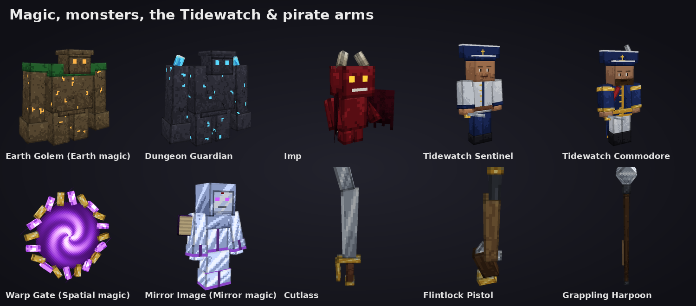

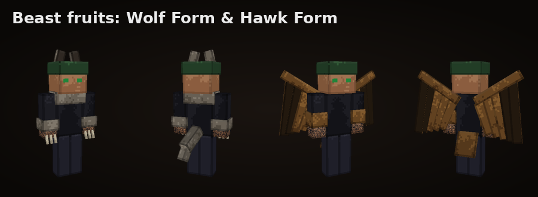


### Four new magic attributes (16 spells)

| Attribute | Spell | Lv | Mana | Cooldown | Effect |
|---|---|---|---|---|---|
| **Spatial** (Four-leaf) | Warp Gate | 1 | 30 | 6s | Open linked gates at your feet and where you look. |
|  | Space Cleave | 3 | 22 | 3s | A slash through space itself - walls cannot stop it. |
|  | Pocket Dimension | 6 | 40 | 10s | Fling every enemy near your aim high into the sky. |
|  | Gate Barrage | 10 | 80 | 22s | Portals surround your target and fire from every side. |
| **Earth** (Three-leaf) | Stone Bullets | 1 | 12 | 0.9s | Three hardened stone bullets. |
|  | Mud Mire | 3 | 26 | 7s | Turn the ground near your aim into sucking mud. |
|  | Earth Golem | 6 | 50 | 30s | Raise a stone golem that fights at your side. |
|  | Continental Quake | 10 | 85 | 24s | Rings of shattering earth roll out from you. |
| **Steel** (Three-leaf) | Steel Lances | 1 | 14 | 1s | Three steel lances that pierce one enemy each. |
|  | Iron Bulwark | 3 | 28 | 14s | Steel skin: huge resistance and attackers are cut. |
|  | Blade Rain | 6 | 40 | 9s | Steel blades rain down on your aim. |
|  | Steel Maelstrom | 10 | 80 | 24s | A whirlwind of orbiting blades shreds everything near you. |
| **Mirror** (Four-leaf) | Mirror Shot | 1 | 16 | 1.4s | A light beam that bounces to a second enemy. |
|  | Mirror Image | 3 | 36 | 20s | Two mirror doubles fight for you. |
|  | Reflection Barrier | 6 | 30 | 12s | For a while, incoming spells and arrows are reflected. |
|  | Kaleidoscope | 10 | 85 | 25s | Mirror panes surround your aim and burn it from every angle. |

At the time of wave 3 the Grimoire Altar picked from 12 attributes (Wind/Flame/Water/Lightning/Ice 11% each, Earth 10%, Steel 9%, Light/Dark 8%, Spatial/Mirror 6%, Anti-Magic 6%).

### All nine squad robes

| Robe | Perk |
|---|---|
| Black Bull Robe | +25% mana regen, +25% spell power below 40% health |
| Golden Dawn Robe | +40 max mana, +10% spell power |
| Crimson Lion Robe | Flame spells cost 15% less and hit 15% harder |
| Silver Eagle Robe | +20% spell power while your mana is above 75% |
| Blue Rose Robe | Healing and shield spells are 30% stronger; +15 max mana |
| Green Mantis Robe | Spell cooldowns are 15% shorter |
| Coral Peacock Robe | Every cast has a 20% chance to refund its mana |
| Purple Orca Robe | Water breathing, and Water/Ice spells hit 15% harder |
| Aqua Deer Robe | Swiftness while out of combat, and +30% mana regen while moving |

New robes are found in dungeon chests (and the original three are still craftable).

### Magic Knight ranks & techniques

* **Stars** for great deeds: Devil +5, Leviathan +5, dungeon Guardian +3, Tidewatch Commodore +2, Raider Captain +1, every 5 levels +1. Each rank adds +5 max mana.
* Ranks: Junior Magic Knight (0★) → Intermediate Magic Knight (3★) → Senior Magic Knight (8★) → First Class Senior Magic Knight (15★) → Vice-Captain (25★) → Magic Knight Captain (40★) → Wizard King Candidate (60★).
* **Mana Skin** (level 12): a coat of mana soaks a quarter of every hit, paid for with mana.
* **Mana Zone** (level 15): hold your grimoire and press **Sneak + Jump**: for 20 s, inside a 12-block zone your spells recharge twice as fast, hit 20% harder and mana regenerates twice as fast.

### Ancient dungeons

While you explore, buried **magic dungeons** form out of sight: a ruined entrance, a stairway, a corridor with **flame traps**, a pillared hall with a working Grimoire Altar, a treasure vault and the **Dungeon Guardian** (220 HP: ground slams, thrown boulders, calls Imps when enraged). Chests hold **Ancient Grimoire Pages** (+60 magic XP each), squad robes, mana crystals, gold, diamonds and treasure maps. **Imps**, small winged devils, also roam at night.

### Four new Abyss Fruits

| Fruit | Passive | Abilities |
|---|---|---|
| **Frost Fruit** | Immune to freezing; the sea freezes under your feet. | **Frost Lance** (1.6s) – Hurl a lance of ice that slows its target.<br>**Glacial Path** (6s) – Freeze a path ahead, encasing enemies in it.<br>**Ice Age** (20s) – Freeze everything around you solid. |
| **Barrier Fruit** | Standing still hardens the air around you (damage resistance). | **Barrier Wall** (8s) – A wall of hardened air blocks the way.<br>**Barrier Dome** (16s) – A dome that shields allies and stops projectiles.<br>**Barrier Crash** (5s) – Shove a barrier forward, crushing enemies. |
| **Wolf Fruit** (beast) | Beast form: speed, keen night sight and sharp claws. | **Pounce** (3s) – Leap onto the enemy you are looking at.<br>**Howl** (18s) – A howl that strengthens you and cows nearby enemies.<br>**Rending Frenzy** (10s) – A flurry of claw strikes in front of you. |
| **Hawk Fruit** (beast) | Beast form: glide by holding Jump while falling; no fall damage. | **Sky Ascent** (6s) – Beat your wings and soar straight up.<br>**Talon Dive** (5s) – Dive onto your aim with crushing talons.<br>**Feather Storm** (2.4s) – A fan of razor feathers. |

Beast fruits show their form (wolf ears, tail and claws, or hawk wings) while you hold the power.

### Your bounty & the Tidewatch

Defeating captains, devils, the Leviathan, Tidewatch officers or other ships raises the **bounty on your head**. Thresholds: Small-time Pirate (300), Notorious Pirate (1500), Sea Tyrant (5000), Scourge of the Seas (12000). Each new tier gives you a **Wanted Poster** of yourself, and the **Tidewatch**, an original naval order, sends squads to hunt you: Sentinels with sabres and, at higher bounties, **Commodores** who sidestep blows and call down cannon bombardments.

### Treasure maps, pirate arms & food

* **Treasure Map** (wreck/dungeon chests, Bounty Board shop): use it to reveal its spot, follow the HUD arrow, then use it on the X to dig up a chest.
* **Cutlass** (` I / I / GS`): a fast sword; use it for a spinning slash.
* **Flintlock Pistol** (` III / FPG / P`): fires **Lead Shot** (iron nugget + gunpowder → 6).
* **Grappling Harpoon** (`  I / S / T  `): spear an enemy and drag it in, or hit a wall to pull yourself over.
* **Hearty Roast** (cooked beef + cooked porkchop + bread → 2): a big meal with regeneration and absorption.

```
/give @s bc:grimoire_spatial     (spatial earth steel mirror)
/give @s bc:fruit_wolf           (frost barrier wolf hawk)
/give @s bc:flintlock
/give @s bc:lead_shot 32
/give @s bc:treasure_map
/summon bc:dungeon_golem
/summon bc:tidewatch_commodore
```

---

## v0.6.0: a grimoire and a fruit

* **Companions** now fight with **one grimoire and one Abyss Fruit**. The tactical brain picks from both - a binding spell from the grimoire, then a fruit volley into the trapped foe. Their fruit's glyph follows their name; hold any Abyss Fruit and talk to them to feed it to them and change their power. → [Companions](docs/companions.md#a-grimoire-and-a-fruit)
* **A new move for every grimoire** at level 12 - from Vacuum Cutter (Wind) and Flame Emperor's Ring (Flame) to Moonlit Prison (Moon) and Ash Phoenix (Ash) - and **Black Hurricane** for Anti-Magic: a spinning sword storm that cuts every spell around you out of the air. → [Magic](docs/magic.md)
* **A fourth power for every Abyss Fruit**, awakening at **Will 2** - Ember Storm, Black Star, Lava Serpent, King's Charge, Phoenix Halo and 25 more. → [Abyss Fruits](docs/fruits.md)

---

## v0.5.0: the companion update

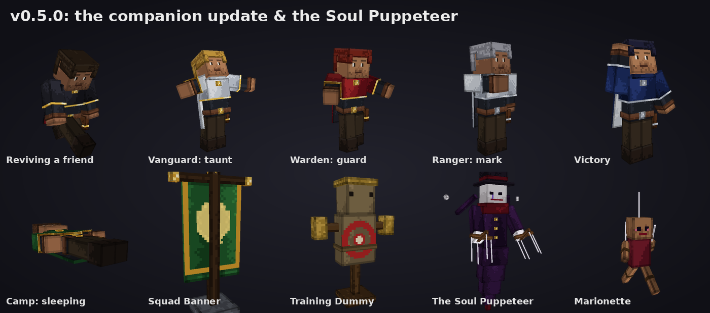


Your Magic Knights become a squad. Everything here is explained in detail in [Companions](docs/companions.md).

| | |
|---|---|
| **Personalities** | Brave, Cautious, Loyal, Hothead, Cheerful, Scholar - they change courage, skill, power, positioning and what they say. |
| **Specialisations** (level 10) | **Vanguard** taunts foes and bosses onto itself and bodyguards you; **Arcanist** hits harder and faster with an Arcane Barrage; **Warden** shields the party (Aegis), cleanses curses, cuts down arrows aimed at you and revives quickly; **Ranger** fights from range with piercing volleys and marks targets. Mastery at level 20 or through a trial. |
| **Party tactics** | Balanced, Focus fire, Protect me, Spread out, Hit and run. |
| **Squad AI** | Combos on bound foes (+25%), marks (+20%), stepping out of warning circles and spell fields, bodyguarding, kiting, focus fire. |
| **Revives** | A fallen companion leaves a glowing clover: sneak beside it, or a squadmate kneels there, and they get back up. |
| **Mood & camp** | Morale and weariness; make camp to rest - with a night watch that raises the alarm - and listen to them banter. |
| **Talk & trials** | Ask how they feel, about their past, for advice. At bond Friend they ask for a personal trial that awakens their grimoire and earns them a title. |
| **Squad Banner** | 6 more knights in reserve, swaps, reserve training, and real-time **expeditions** for loot and XP. |
| **Practice** | Training Dummy (shows your DPS; companions practise on it), sparring matches, **rival squads** challenging your party. |
| **Flying** | Mount a broom and your companions fly theirs in formation behind you. |

Plus **Gravity, Moon, Thorn and Ash** magic, and **the Soul Puppeteer** - a boss whose strings take control of your companions (strike them or Cleanse them to set them free). → [Changelog](CHANGELOG.md)

---

## v0.3.0: brooms, missions & new foes

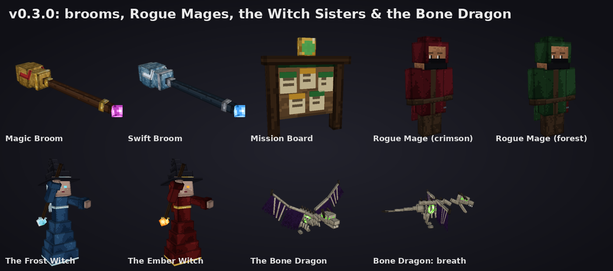


* **Magic brooms** - craft a Magic Broom (stick, hay block, mana crystal) or a Swift Broom and **fly on your mana**: look to steer, hold forward to fly, back to brake, let go to hover, sneak to step off (the broom returns to your pack). Your mana does not regenerate in the air; run dry and you glide down. → [Brooms](docs/progression.md#magic-brooms)
* **Daily missions** - three missions a day (kills, bosses, Devil Gates, spells, XP, deliveries, companion victories) turned in at a **Mission Board** for stars, doubloons and XP. → [Missions](docs/progression.md#daily-missions)
* **Amulets** - Mana Heart, Swift Sigil, Battle Charm, Guardian Ward and Vigor Band, held in the off hand. → [Amulets](docs/progression.md#amulets)
* **Awakened spells** - every grimoire except Anti-Magic awakens a fifth, strongest spell at magic level 15 (Gale Emperor, Crown of Suns, Ocean Sovereign, Thousand Bolts…); knights and companions awaken too. → [Magic](docs/magic.md)
* **Rogue Mages** - outlaw mages with a real grimoire and levels 2-8 who fight with the tactical brain; they prowl at night, ambush travellers and form a War Table army. → [Mobs](docs/mobs-and-bosses.md)
* **The Witch Sisters** - a twin boss: the Frost Witch and the Ember Witch blink away from melee and weave **Twin Spells**; kill one and the other goes berserk. Summon them with a **Twin Moon Charm**. → [Bosses](docs/mobs-and-bosses.md#bosses)
* **The Bone Dragon** - circles overhead, breathes withering bone-fire, dives, sweeps its tail, raises skeletons and ends with Death's Wingbeat. Summon it with a **Bone Totem**. → [Bosses](docs/mobs-and-bosses.md#bosses)
* **Magic Knight camps**, three new world events (rogue ambush, Witch Sisters, Bone Dragon) and more merchant wares. → [Changelog](CHANGELOG.md)

---

## v0.2.0: companions, smarter enemies & bosses

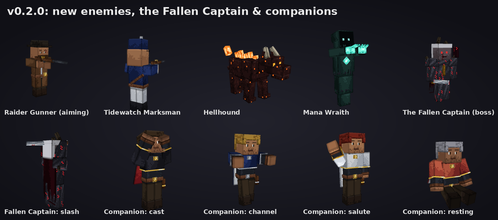

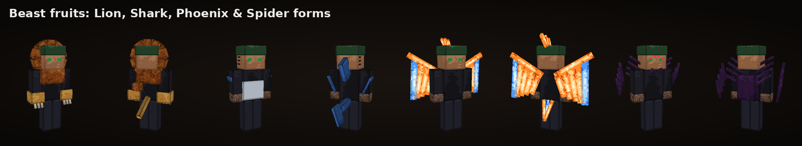


* **Companions** - recruited knights become a saved party of up to 4 with levels to 20, bonds (Mana Link, Guardian, Union Magic), gifts, robes, stances, formations and a **Companion Whistle** (sneak + use at a foe: everyone attacks it). They attack what you attack, protect you, heal you first, keep out of your line of fire and come back 60 s after they fall. → [Companions](docs/companions.md)
* **Smarter enemies** - Disciples, Imps, Raiders, the new Gunners and Marksmen, pack-hunting Hellhounds and mana-draining Wraiths use the tactical brain; hurt one and its kind come running. → [Enemy brains](docs/ai-and-simulation.md#enemy-brains)
* **Smarter bosses** - threat tables, three phases with desperation moves, telegraphed blows, blinking, submerging and ramming, an enrage timer, and the new **Fallen Captain**. → [Boss brains](docs/ai-and-simulation.md#boss-brains-bossesjs)
* **More content** - Cotton, Paper, Smoke, Glass, Gold, Beast, Spirit and Rune magic; Spore, Thread, Slime, Chain, Lion, Shark, Phoenix and Spider fruits; four new events. → [Changelog](CHANGELOG.md)

---

## v0.1.0: AI behaviour & simulation

This early-access release is mostly about **how things fight and how the world moves**.

### The tactical brain
Magic Knights and Raider Captains are driven by one shared brain (`src/scripts/living/ai.js`):

| | |
|---|---|
| **Fighting style** | Worked out from the spells it knows: *striker* (bolts, beams), *controller* (prisons, zones, vortices), *brawler* (novas, dashes, dives) or *support* (heals, buffs). |
| **Traits** | **Skill** (aim, dodging, how fast it reacts) and **courage** (when it falls back). Shown on its profile. |
| **Spell choice** | Every cast, each known spell is scored for the moment: range to the target, how many enemies are bunched around it, how many are close, hurt allies, its own health, cooldowns. The best one is cast – a little randomly for low-skill NPCs. |
| **Aiming** | Leads moving targets by their velocity; better skill means less wobble. |
| **Dodging** | Spells and arrows on a collision course are side-stepped (chance grows with skill). |
| **Targets** | Prefers the army's **focus target** (the weakest foe near its centre), whoever just hurt it, and enemy leaders; sticks to a target instead of thrashing. |
| **Positioning** | Spellcasters back away from foes that get within ~4.5 blocks; brawlers dive in; badly hurt cowards fall back toward friends. |

### Battles
* **Tactics** per army – *Charge*, *Hold the line*, *Flank*, *Skirmish* – and a **formation** with melee in front and mages behind.
* **Morale** drops with every loss (a lot when the leader falls) and when an army is outnumbered 1.5:1 or worse; below 30 soldiers start to **flee**, above 55 they **rally** to a living leader. An army with nobody left fighting loses.
* **Leaders** give soldiers within 10 blocks Strength; the army's focus target is re-picked every second.
* **Three armies** at once (Blue, Red, Gold), **knight duels**, a live **scoreboard** sidebar, a **kill feed**, a **battle report** with an MVP, and a **cinematic camera** (sneak to stop).

### The world simulation
* Each of the four factions has a **power** from 0 to 100 (start 50). Deaths lower it, real battle wins raise it (War Table games do not count), and every five minutes it drifts back toward the middle while rivals clash off screen.
* Event odds follow power (a strong Devil Host means more Devil Gates and Crimson Nights). At 80+ a faction launches an **offensive**: a 7–9 a side battle near a player.
* The **State of the Kingdom** page shows power bars and the last ten news items.

### Leading knights
* Knights level up (1–10) from kills and learn their third spell at level 3 and their ultimate at level 6.
* Talk to a knight to see its profile and **recruit** it (a Knight Contract, or 100 + 25 × level doubloons; up to 4).
* Talk to your own knights to order them to **follow**, **hold this position**, switch between **aggressive** and **defensive** (guard you), or **release** them.

```
/scriptevent bc:event knight_tournament
/summon bc:magic_knight
```

---

## Wave 4: a living world

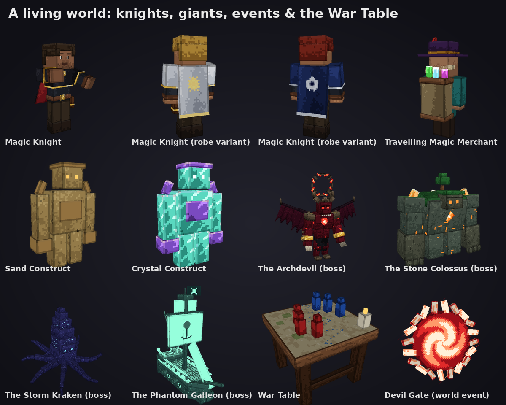

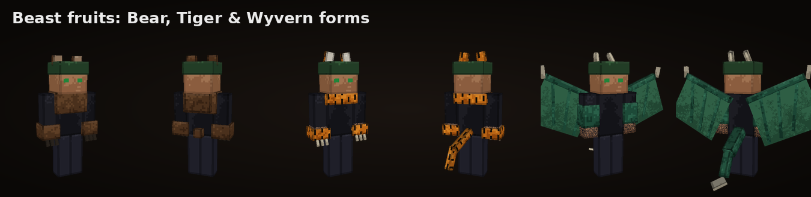

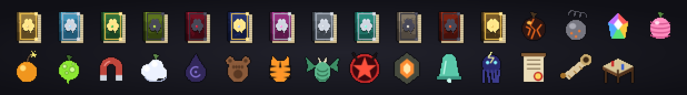

The world now moves on its own. **Magic Knights** roam and hunt monsters, factions fight each other, giant bosses wake up, and every few minutes a **world event** happens near you. A new **spell engine** runs every new spell and fruit ability from a short recipe in `tools/bc/data.py`, so the pack now has **24 grimoires (96 spells)** and **22 Abyss Fruits (66 abilities)**.

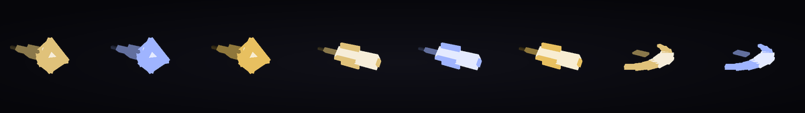

### Twelve new magic attributes (48 spells)

| Attribute | Spell | Lv | Mana | Cooldown | Effect |
|---|---|---|---|---|---|
| **Sand** (Three-leaf) | Sand Bullets | 1 | 10 | 0.6s | Three grains of hardened sand that grind foes down. |
|  | Quicksand | 3 | 26 | 7s | The ground near your aim becomes sucking quicksand. |
|  | Sand Coffin | 6 | 40 | 9s | Bury enemies near your aim in sand, then crush them. |
|  | Desert Storm | 10 | 80 | 24s | A roaring sandstorm around you blinds and shreds foes. |
| **Bubble** (Three-leaf) | Bubble Shot | 1 | 8 | 0.5s | A big bubble that pops with a stunning burst. |
|  | Bubble Barrage | 3 | 22 | 3s | A fan of seven popping bubbles. |
|  | Bubble Prison | 6 | 34 | 9s | Trap enemies in floating bubbles and lift them away. |
|  | Foam Flood | 10 | 72 | 22s | A wide wall of crashing foam rolls over everything ahead. |
| **Plant** (Three-leaf) | Thorn Seeds | 1 | 12 | 0.8s | Three thorned seeds that poison what they hit. |
|  | Vine Snare | 3 | 24 | 6s | Vines burst up and bind enemies near your aim. |
|  | Healing Garden | 6 | 34 | 14s | A blooming garden heals you and your allies. |
|  | Great Tree Wrath | 10 | 85 | 26s | Giant roots erupt all around you and hurl foes skyward. |
| **Poison** (Three-leaf) | Venom Needles | 1 | 10 | 0.6s | Two needles dripping with venom. |
|  | Toxic Mist | 3 | 28 | 8s | A cloud of choking poison settles over your aim. |
|  | Serpent Fang | 6 | 36 | 7s | A venom serpent fang that pierces a line of foes. |
|  | Plague Bloom | 10 | 80 | 24s | A flower of plague bursts open around you. |
| **Blood** (Three-leaf) | Blood Lances | 1 | 6 | 0.7s | Three lances of blood that heal you as they hit. Costs 2 health. |
|  | Crimson Drain | 3 | 18 | 4s | A beam that drains the life of everything it touches. |
|  | Blood Rage | 6 | 20 | 18s | Spend your own blood for raw power and speed. Costs 6 health. |
|  | Sanguine Moon | 10 | 80 | 26s | A blood moon strikes every foe around you and feeds you. Costs 8 health. |
| **Star** (Four-leaf) | Star Shards | 1 | 14 | 1s | A spray of five shards of starlight. |
|  | Constellation | 3 | 30 | 8s | Stars lock onto enemies near your aim and strike them. |
|  | Comet Fall | 6 | 48 | 12s | Call a comet down on your aim. |
|  | Supernova | 10 | 90 | 26s | Explode with the light of a dying star. |
| **Sound** (Three-leaf) | Sonic Pulse | 1 | 10 | 0.6s | A ringing pulse that passes through foes. |
|  | Resonance | 3 | 24 | 6s | A shattering chord blasts everything away from you. |
|  | War Song | 6 | 30 | 20s | A battle song that strengthens you and your allies. |
|  | Sonic Boom | 10 | 78 | 22s | A deafening boom that tears through everything ahead. |
| **Mist** (Three-leaf) | Mist Needles | 1 | 10 | 0.6s | Three needles of condensed mist. |
|  | Vanishing Mist | 3 | 26 | 16s | Vanish into a thick mist that blinds those nearby. |
|  | Phantom Step | 6 | 18 | 3s | Blink through the mist, cutting everything you pass. |
|  | Mist Labyrinth | 10 | 70 | 24s | Trap your foes in a maze of mist that saps their strength. |
| **Crystal** (Three-leaf) | Crystal Shards | 1 | 12 | 0.8s | Three razor crystal shards. |
|  | Prism Wall | 3 | 24 | 12s | Raise a wall of crystal. |
|  | Crystal Lances | 6 | 36 | 7s | Crystal lances burst from the ground in a line. |
|  | Diamond Storm | 10 | 82 | 24s | Two rings of diamond shards blast out from you. |
| **Bone** (Three-leaf) | Bone Spear | 1 | 12 | 0.8s | A heavy spear of bone that pierces one foe. |
|  | Ribcage Prison | 3 | 28 | 9s | A cage of ribs snaps shut around enemies near your aim. |
|  | Bone Legion | 6 | 50 | 30s | Raise two bone warriors to fight for you. |
|  | Graveyard | 10 | 80 | 24s | Bone spikes tear out of the ground in eight directions. |
| **Magma** (Three-leaf) | Magma Ball | 1 | 14 | 0.9s | A lobbed ball of magma that bursts into flame. |
|  | Lava Geyser | 3 | 30 | 7s | Geysers of lava erupt at your aim. |
|  | Molten Wall | 6 | 30 | 12s | Raise a wall of glowing magma. |
|  | Eruption | 10 | 85 | 26s | Lava bombs rain down around your aim. |
| **Time** (Four-leaf) | Clock Hands | 1 | 12 | 0.8s | Two clock-hand blades that slow what they cut. |
|  | Rewind | 3 | 34 | 20s | Turn back your own clock to where you stood 3 seconds ago, and heal. |
|  | Accelerate | 6 | 30 | 22s | Speed up your own time. |
|  | Time Stop | 10 | 90 | 30s | Stop time for every foe around you. When it flows again, the hits land at once. |

The Grimoire Altar picks from all 24 attributes: Wind 5.9%, Flame 5.9%, Water 5.9%, Lightning 5.9%, Ice 5.9%, Earth 5.4%, Steel 4.9%, Plant 4.9%, Light 4.3%, Dark 4.3%, Sand 4.3%, Bubble 4.3%, Poison 3.8%, Sound 3.8%, Mist 3.8%, Crystal 3.8%, Magma 3.8%, Spatial 3.2%, Mirror 3.2%, Bone 3.2%, Anti-Magic 2.7%, Blood 2.7%, Star 2.2%, Time 1.6%.

### Twelve new Abyss Fruits

| Fruit | Passive | Abilities |
|---|---|---|
| **Lava Fruit** | Immune to fire and lava; your blows scorch. | **Lava Fist** (1.8s) – Lob a fist of molten rock that bursts into flame.<br>**Magma Pool** (8s) – Turn the ground near your aim into a burning pool.<br>**Volcanic Rain** (20s) – Lava bombs pour down around your aim. |
| **Ash Fruit** | Your body turns to ash: blows sometimes pass right through you. | **Cinder Spear** (2s) – A spear of glowing cinders that pierces foes.<br>**Ash Veil** (9s) – A choking veil of ash smothers your aim.<br>**Ash Cyclone** (16s) – A cyclone of ash drags foes in and burns them. |
| **Prism Fruit** | Your eyes drink in light: you see clearly in the dark. | **Prism Ray** (2.5s) – A blazing ray of split light.<br>**Rainbow Burst** (8s) – Sixteen shards of colour burst out from you.<br>**Refraction** (4s) – Bend the light and appear further ahead. |
| **Bounce Fruit** | Springy body: you jump higher and never take fall damage. | **Ricochet** (3s) – Bounce forward, slamming into everything in your path.<br>**Recoil Wave** (7s) – A springy shock that flings everything away from you.<br>**Meteor Bounce** (12s) – Spring sky-high and crash down on your aim. |
| **Blast Fruit** | Your punches go off with a small blast. | **Blast Shot** (1.6s) – A shot that explodes on impact.<br>**Mine Field** (9s) – Scatter blast mines around your aim.<br>**Big Bang** (18s) – Detonate yourself in a huge (harmless to you) explosion. |
| **Acid Fruit** | Acid blood: poison can never take hold of you. | **Acid Spit** (1.6s) – Three globs of acid that weaken foes.<br>**Acid Rain** (10s) – Acid rains down on your aim.<br>**Corrode** (6s) – A stream of acid that eats through armour and flesh. |
| **Lodestone Fruit** | Magnetic body: arrows veer away from you. | **Magnet Pull** (5s) – Drag every foe near your aim together and crush them.<br>**Magnet Push** (6s) – Repel everything around you.<br>**Iron Tempest** (16s) – Iron blades spin out from you in every direction. |
| **Cloud Fruit** | Light as a cloud: you drift down slowly when sneaking in the air. | **Thunderhead** (6s) – Thunder strikes foes near your aim.<br>**Cloud Ride** (12s) – Rise on a cloud and drift where you like.<br>**Downpour** (10s) – A cold downpour that slows and soaks foes. |
| **Ink Fruit** | Ink seeps from your wounds and blinds whoever hit you. | **Ink Blot** (1.6s) – Three blots of blinding ink.<br>**Ink Serpent** (6s) – A serpent of ink that coils through a line of foes.<br>**Ink Sea** (16s) – Flood the ground around you with ink. |
| **Bear Fruit** (beast) | Beast form: crushing strength and a thick hide. | **Maul** (1.6s) – A crushing swipe at everything in front of you.<br>**Roar** (16s) – A roar that weakens and slows every foe nearby.<br>**Ground Slam** (10s) – Leap and slam the earth on your aim. |
| **Tiger Fruit** (beast) | Beast form: blinding speed and keen night sight. | **Lunge** (3s) – Lunge forward, tearing through your path.<br>**Claw Rush** (7s) – Four lightning-fast claw strikes.<br>**Predator** (20s) – Enter the hunt: speed, strength and night sight. |
| **Wyvern Fruit** (beast) | Beast form: wings to glide on and a hide that ignores fire. | **Wyvern Breath** (3s) – A roaring stream of dragonfire.<br>**Wing Gust** (6s) – A beat of your wings blasts everything away.<br>**Sky Dive** (12s) – Soar up and dive onto your aim in flames. |

Beast fruits show their form (bear ears and claws, tiger stripes and tail, wyvern wings and horns) while you hold the power. Raider Captains can now carry any of the 22 fruits.

### Giant bosses

| Boss | Summon with | What it does |
|---|---|---|
| **The Archdevil** (900 HP) | **Archdevil Sigil** – crying obsidian ×4, mana crystal ×4, devil heart | Flies. Dark lances, hellfire rain, a crushing crimson nova, calls imps; enraged: void vortex and a meteor storm. |
| **The Stone Colossus** (1200 HP) | **Colossus Core** – mossy cobblestone ×4, ancient page ×4, diamond block | A walking mountain with a tree on its back. Ground slams, thrown boulders, eight-way earth splits; enraged: magma meteors and sand coffins. |
| **The Phantom Galleon** (800 HP) | **Phantom Galleon Bell** – phantom membrane ×4, doubloon ×4, bell | A ghost ship that sails the sky above you, fires cannon broadsides and drops its drowned crew (Phantom Raiders). |
| **The Storm Kraken** (1000 HP) | **Storm Kraken Lure** – Leviathan scale ×4, lightning rod ×4, heart of the sea (use it near deep water) | Lightning strikes, tentacle waves, whirlpools, bubble prisons; enraged it calls a thunderstorm. |

Every boss has a boss bar, a second phase below half health, big loot, and gives **stars** to everyone who fought it.

### World events

Every 4–7 minutes, one of these happens near a random player (toggle at a War Table, or trigger with `/scriptevent bc:event <name>`):

| Event | |
|---|---|
| `meteor_shower` | Mana meteors rain down for thirty seconds; fallen stars can leave mana crystals. |
| `devil_gate` | A Devil Gate opens and pours out imps and Dark Disciples. Break it (120 HP) for XP and a star – leave it and the Archdevil may step through. |
| `pirate_landing` | A Raider Captain and a raiding party come ashore. |
| `skirmish` | Two random factions clash nearby – watch, or join in. |
| `knight_patrol` | A patrol of Magic Knights passes by (day). |
| `merchant` | The **Travelling Magic Merchant** sets up shop for six minutes. |
| `sky_treasure` | A golden beam marks a treasure chest falling from the sky – pirates go for it too. |
| `crimson_night` | Under a red moon, devils swarm for two minutes and give extra magic XP (night). |
| `colossus` / `phantom_galleon` / `kraken` | A giant boss rises (Colossus by day, Galleon by night, Kraken near deep water). |

### Magic Knights, factions and the War Table

* **Magic Knights** spawn in plains, forests, meadows and savannas. Each has a name, one of 23 attributes (shown by the glyph over their head) and one of the nine squad robes. They cast real spells at monsters, pirates and devils – and only fight you if you hit them first.
* **Knight Contract** (emerald ×4, paper ×4, mana crystal): a Magic Knight joins you, follows you and defends you.
* **Factions in the wild:** knights fight devils and pirates; the Tidewatch also hunt devils and Dark Disciples; pirates and devils attack knights and the navy.
* **War Table** (map, iron sword, feather / planks ×3 / sticks): a battle simulator (see v0.1.0 above for tactics, morale, duels and the camera). Pick two or three armies from **Clover Magic Knights**, **Devil Host**, **Sea Raiders**, **Tidewatch Navy**, **Ancient Constructs**, choose 2–12 soldiers a side, decide whether leaders (captains, commodores) join, and **bet doubloons** – win and you get double. Soldiers only fight the other army.
* **Skirmish Horn** (bone, gold ingot ×2): two random armies clash right in front of you.

### The Travelling Magic Merchant

| Ware | Doubloons |
|---|---|
| Mana Crystals x8 | 30 |
| Ancient Grimoire Pages x2 | 60 |
| Mystery Abyss Fruit | 450 |
| Knight Contract (hire a Magic Knight) | 140 |
| Skirmish Horn | 90 |
| Archdevil Sigil | 600 |
| Colossus Core | 500 |
| Phantom Galleon Bell | 500 |
| Storm Kraken Lure | 550 |
| Wishing Clover Charm | 900 |

```
/give @s bc:grimoire_time       (sand bubble plant poison blood star sound mist crystal bone magma time)
/give @s bc:fruit_wyvern        (lava ash prism bounce blast acid lodestone cloud ink bear tiger wyvern)
/give @s bc:war_table
/give @s bc:archdevil_sigil     (colossus_core galleon_bell kraken_lure)
/give @s bc:knight_contract
/summon bc:magic_knight
/summon bc:magic_merchant
/scriptevent bc:event skirmish
```

---

## Building from source

Everything in `packs/` and `dist/` is generated. Requirements: Python 3.10+, `numpy`, `Pillow`, and `ffmpeg` (for the OGG sounds).

```
python3 tools/build.py        # models, textures, particles, sounds, JSON, scripts -> packs/ and dist/
python3 tools/validate.py     # cross-checks every texture/model/animation/particle/sound reference
python3 tools/previews.py     # re-renders the images in docs/images
python3 tools/docs.py         # regenerates the reference pages in docs/
```

| Path | What it is |
|---|---|
| `tools/bc/data.py` | attributes, spells, swords, robes (single source of truth, also exported to the scripts) |
| `tools/bc/models/` | 3D models (grimoires, swords, robes, altar, spells, mobs, ship, raiders, Leviathan, fruit auras) and their animations |
| `tools/bc/seagen.py`, `structures.py` | Abyssal Seas pack content and the outpost / wreck blueprints |
| `tools/bc/grandgen.py`, `wave4gen.py` | wave 3 and wave 4 pack content (bosses, knights, the War Table, faction team groups) |
| `src/scripts/living/` | the spell engine, tactical AI brain (`ai.js`), knights, battle simulation, world simulation (`worldsim.js`), bosses, world events, merchant, War Table |
| `tools/bc/tex.py` | procedural pixel-art material painter |
| `tools/bc/geo.py`, `render.py` | Bedrock geometry builder with UV atlas packing, and a software preview renderer |
| `tools/bc/fx.py` | particle textures and particle effects |
| `tools/bc/audio.py` | synthesised sound effects |
| `tools/bc/packgen.py` | items, blocks, entities, recipes, loot, spawn rules, client entities, attachables |
| `src/scripts/` | gameplay scripts (`@minecraft/server` 2.0.0, JavaScript modules); the expansion lives in `src/scripts/sea/` |

The scripts are type-checked against the official `@minecraft/server` 2.0.0 typings (`tsc --checkJs`).

**Releasing:** bump `VERSION` in `tools/bc/packgen.py`, add a section to `CHANGELOG.md`, rebuild, commit, then push a tag such as `v0.6.0`. The [release workflow](.github/workflows/release.yml) attaches the `.mcaddon` / `.mcpack` files and uses the changelog section as release notes.

**Tuning held items:** third/first-person poses live in `grimoire_animations()` and `sword_animations()` in `tools/bc/models/items.py`. First-person poses are solved from a target screen position by `tools/bc/fpsolve.py`, so moving an item on screen means changing one target point.

## License

Code: MIT (see [LICENSE](LICENSE)). Black Clover is © Yūki Tabata / Shueisha; this is a non-commercial fan project.
