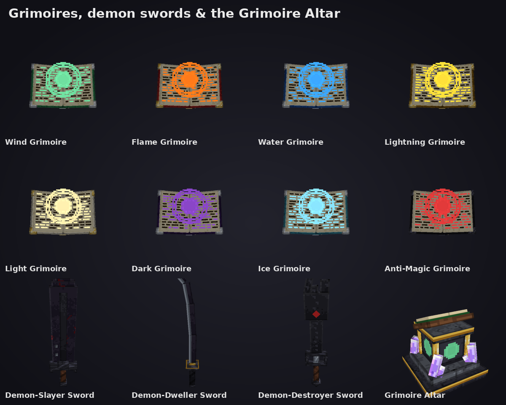

# Black Clover: Grimoire Awakening

**An unofficial Black Clover fan addon for Minecraft Bedrock Edition** – receive your own grimoire, master one of eight magic attributes, draw anti-magic demon swords, wear Magic Knight squad robes and fight Dark Disciples and a full Devil boss.


Every model, texture, particle, sound and icon in this pack is original and generated from source code in [`tools/`](tools/) – no art or audio from the anime is used.

> Unofficial fan-made content. Not affiliated with or endorsed by Yūki Tabata, Shueisha, Studio Pierrot or Mojang/Microsoft.

---

## Features

* **8 grimoires, 32 spells** – Wind, Flame, Water, Lightning, Ice, the rarer Light and Dark (four-leaf), and the very rare five-leaf **Anti-Magic** grimoire.
* **3D held grimoires** – your grimoire floats open beside your shoulder with flipping pages, glowing rune text and a spinning magic sigil (first-person view included).
* **3D anti-magic swords** – Demon-Slayer, Demon-Dweller and Demon-Destroyer, each with its own ability, spell-cutting and an Anti-Magic gauge that powers **Black Form**.
* **3D spell entities with animations** – wind crescents, fireballs, a roaring flame lion, a serpentine water dragon, a spinning tornado, thunder spears, swords of light, dark crescents, a black hole, ice spears and ice prisons.
* **47 custom particle effects** – magic circles that face your cast direction, ground circles, element trails, shockwaves, lightning strikes, black anti-magic crackle, clover leaves, snowstorms and more.
* **15 custom sound effects** synthesised for the addon (cast shimmer, page flips, anti-magic slashes, Black Form roar, level-up chime, Devil roar…).
* **Mana, levels and progression** – mana bar HUD made from custom font glyphs, magic XP, 20 levels, new spells at levels 3 / 6 / 10.
* **The Grimoire Altar** – a 3D block with a ceremony that chooses your attribute.
* **Magic Knight robes** – Black Bull, Golden Dawn and Crimson Lion capes (3D, animated cape) with set perks.
* **Enemies** – Dark Disciples (hooded mages that cast dark bolts and blink behind you) and the **Devil** boss (420 HP, two phases, boss bar, dark lightning, summons, roar, orb barrages).
* **Magic Knight's Handbook** – in-game menu for your stats, spell selection, every attribute's spell list and a guide.
* Player cast / slash / guard animations, camera shake, titles.

| Spells | Grimoires & swords |
|---|---|
|  |  |

| Enemies | Robes |
|---|---|
|  |  |


---

## Install

1. Download **[`dist/BlackClover_GrimoireAwakening.mcaddon`](dist/BlackClover_GrimoireAwakening.mcaddon)** and open it – Minecraft imports both packs.
   (Separate `.mcpack` files for the behavior and resource packs are in [`dist/`](dist/) too.)
2. Create or edit a world → **Behavior Packs** → activate *Black Clover: Grimoire Awakening* (the resource pack is added automatically).
3. Requires **Minecraft Bedrock 1.21.90 or newer**. No experimental toggles are needed – the scripts only use the stable `@minecraft/server` 2.0.0 and `@minecraft/server-ui` 2.0.0 APIs.

## How to play

1. On your first spawn you receive a **Grimoire Altar** and the **Magic Knight's Handbook**.
2. Place the altar and **interact** with it. After a short ceremony a grimoire chooses you
   (weights: 14% each for Wind / Flame / Water / Lightning / Ice, 11% each for Light / Dark, 8% for Anti-Magic).
3. Hold your grimoire:
   * **Use** (right-click / tap & hold) – cast the selected spell.
   * **Sneak + Use** – flip to the next unlocked spell (or pick one in the Handbook).
4. The HUD above the hotbar shows the selected spell, its cooldown, your mana bar and level.
5. Casting and defeating monsters gives magic XP. Spells unlock at **levels 1, 3, 6 and 10**; spell power grows with every level (max 20).
6. Lost your grimoire? Interact with any Grimoire Altar to get it back. Want a different attribute? Use a **Wishing Clover Charm**.

### Anti-Magic

A five-leaf grimoire holds no spells – its pages hold demon swords. "Cast" a page to draw that sword.

| Sword | Use ability | Notes |
|---|---|---|
| Demon-Slayer Sword | **Black Meteorite** – a piercing anti-magic slash wave that also cuts enemy spells out of the air | 12 attack damage |
| Demon-Dweller Sword | **Spell Return** – swallows every hostile spell/projectile within 8 blocks and fires them back as anti-magic slashes (a flash-slash dash if nothing is nearby) | fast blade |
| Demon-Destroyer Sword | **Curse-Breaker Thrust** – dash that strips every effect from enemies it hits and cleanses your own debuffs | 10 attack damage |

* Sword hits fill the **Anti-Magic gauge** (also filled by taking hits and killing magical enemies). At 100% cast **Black Form** for 30 s of strength, speed, resistance, black lightning aura and stronger sword abilities.
* **Sneak** while holding a demon sword to automatically cut down incoming spells and projectiles.
* Demon swords deal bonus damage to magical enemies (Dark Disciples, the Devil) and strip their buffs.

### Spells

| Attribute | Spell | Lv | Mana | Cooldown | Effect |
|---|---|---|---|---|---|
| **Wind** (Three-leaf) | Gale Blades | 1 | 14 | 0.8s | Fires a fan of three cutting wind crescents. |
|  | Cyclone Step | 3 | 18 | 3s | Dash forward on a gust, flinging foes aside. |
|  | Tempest Tornado | 6 | 40 | 8s | A roaming tornado that drags enemies skyward. |
|  | Storm Ascension | 10 | 70 | 20s | Erupt into the sky with a devastating wind burst. |
| **Flame** (Three-leaf) | Flame Bullet | 1 | 12 | 0.7s | A searing fireball that ignites on impact. |
|  | Blazing Pillar | 3 | 24 | 4s | Pillars of fire erupt where you look. |
|  | Inferno Lion | 6 | 45 | 9s | A roaring lion of flame that explodes on impact. |
|  | Solar Nova | 10 | 75 | 22s | An expanding ring of solar fire around you. |
| **Water** (Three-leaf) | Water Bullet | 1 | 10 | 0.5s | Rapid pressurised water orbs. |
|  | Healing Spring | 3 | 30 | 10s | Restores health to you and nearby allies. |
|  | Sea Dragon Roar | 6 | 45 | 9s | A water dragon that pierces through every enemy. |
|  | Tidal Prison | 10 | 70 | 22s | Traps all nearby enemies in crushing water bubbles. |
| **Lightning** (Three-leaf) | Thunder Spear | 1 | 14 | 0.8s | A lightning spear that chains between foes. |
|  | Flash Step | 3 | 16 | 2.5s | Blink forward in a flash, shocking anything in the path. |
|  | Thunder Fiend Armor | 6 | 40 | 25s | Clad yourself in lightning: speed, haste and shock strikes. |
|  | Heaven's Judgment | 10 | 80 | 24s | Call down a storm of judgment bolts on all foes. |
| **Light** (Four-leaf) | Swords of Light | 1 | 22 | 1.5s | Summon blades of light that hunt your target. |
|  | Light Speed | 3 | 20 | 3s | Move at the speed of light. |
|  | Holy Ray | 6 | 40 | 7s | A piercing beam of pure light. |
|  | Radiant Rain | 10 | 85 | 25s | A rain of light swords over the battlefield. |
| **Dark** (Four-leaf) | Dark Crescent | 1 | 18 | 1.2s | A cloaked crescent slash that pierces through foes. |
|  | Abyssal Hole | 3 | 38 | 9s | A black hole that devours enemies and magic. |
|  | Shadow Cloak | 6 | 30 | 20s | Vanish into darkness and strike unseen. |
|  | Dimension Rift Slash | 10 | 90 | 26s | A slash that cuts through space itself. |
| **Ice** (Three-leaf) | Ice Spear | 1 | 12 | 0.7s | A crystal spear that chills its target. |
|  | Frost Prison | 3 | 30 | 8s | Encase enemies around your target in ice. |
|  | Glacier Wall | 6 | 26 | 10s | Raise a temporary wall of glacial ice. |
|  | Absolute Zero | 10 | 80 | 24s | A blizzard that freezes everything around you. |
| **Anti-Magic** (Five-leaf) | Demon-Slayer Sword | 1 | - | 2s | Draw the massive Demon-Slayer Sword from your grimoire. |
|  | Demon-Dweller Sword | 3 | - | 2s | Draw the Demon-Dweller Sword, which returns spells. |
|  | Demon-Destroyer Sword | 6 | - | 2s | Draw the Demon-Destroyer Sword, which breaks curses. |
|  | Black Form | 10 | gauge 100% | 45s | Unleash the devil within. Requires a full Anti-Magic gauge. |

### Magic Knight robes (chest slot)

| Robe | Recipe | Perk |
|---|---|---|
| Black Bull Robe | black wool ×7, gold nugget, mana crystal | +25% mana regen, +25% spell power below 40% HP |
| Golden Dawn Robe | white wool ×7, gold ingot, mana crystal | +40 max mana, +10% spell power |
| Crimson Lion Robe | red wool ×7, blaze powder, mana crystal | Flame spells cost 15% less and hit 15% harder |

All robes give 6 armor points, can be enchanted and repaired with mana crystals.

### Items & crafting

| Item | Recipe | Use |
|---|---|---|
| Mana Crystal ×2 | amethyst shard + lapis lazuli + glowstone dust (shapeless) | restores 45 mana (or +20% anti-magic gauge) |
| Grimoire Altar | `MBM / GLG / SSS` – M mana crystal, B book, G gold ingot, L lectern, S stone bricks | receive / recover your grimoire |
| Magic Knight's Handbook | book + mana crystal | stats, spell picker, guide |
| Devil Summoning Contract | `CMC / MBM / CMC` – C crying obsidian, M mana crystal, B book | summons the Devil boss where you look |
| Wishing Clover Charm | `EME / MHM / EME` – E emerald, M mana crystal, H Devil Heart | give up your grimoire and roll a new one |

### Enemies

* **Dark Disciple** – spawns on the surface at night. Casts dark bolts (weakness), blinks behind attackers when hurt. Drops mana crystals.
* **Devil** – summoned with a contract. Hovers and circles you, claws at close range and uses dark lightning, a darkness roar, orb barrages and summons Disciples. Below 50% HP it enters a faster, angrier second phase. Drops the **Devil Heart**, mana crystals and diamonds.

### Commands (creative / testing)

```
/give @s bc:grimoire_wind        (any attribute: wind flame water lightning light dark ice anti)
/give @s bc:demon_slayer_sword
/give @s bc:grimoire_altar
/summon bc:devil
/summon bc:dark_disciple
```

Players in **creative mode** can use any grimoire with every spell unlocked and infinite mana.

---

## Building from source

Everything in `packs/` and `dist/` is generated. Requirements: Python 3.10+, `numpy`, `Pillow`, and `ffmpeg` (for the OGG sounds).

```
python3 tools/build.py        # models, textures, particles, sounds, JSON, scripts -> packs/ and dist/
python3 tools/validate.py     # cross-checks every texture/model/animation/particle/sound reference
python3 tools/previews.py     # re-renders the images in docs/images
```

| Path | What it is |
|---|---|
| `tools/bc/data.py` | attributes, spells, swords, robes (single source of truth, also exported to the scripts) |
| `tools/bc/models/` | 3D models (grimoires, swords, robes, altar, spells, mobs) and their animations |
| `tools/bc/tex.py` | procedural pixel-art material painter |
| `tools/bc/geo.py`, `render.py` | Bedrock geometry builder with UV atlas packing, and a software preview renderer |
| `tools/bc/fx.py` | particle textures and particle effects |
| `tools/bc/audio.py` | synthesised sound effects |
| `tools/bc/packgen.py` | items, blocks, entities, recipes, loot, spawn rules, client entities, attachables |
| `src/scripts/` | gameplay scripts (`@minecraft/server` 2.0.0, JavaScript modules) |

The scripts are type-checked against the official `@minecraft/server` 2.0.0 typings (`tsc --checkJs`).

**Tuning held items:** third/first-person poses live in `grimoire_animations()` and `sword_animations()` in `tools/bc/models/items.py`. First-person poses are solved from a target screen position by `tools/bc/fpsolve.py`, so moving an item on screen means changing one target point.

## License

Code: MIT (see [LICENSE](LICENSE)). Black Clover is © Yūki Tabata / Shueisha; this is a non-commercial fan project.
