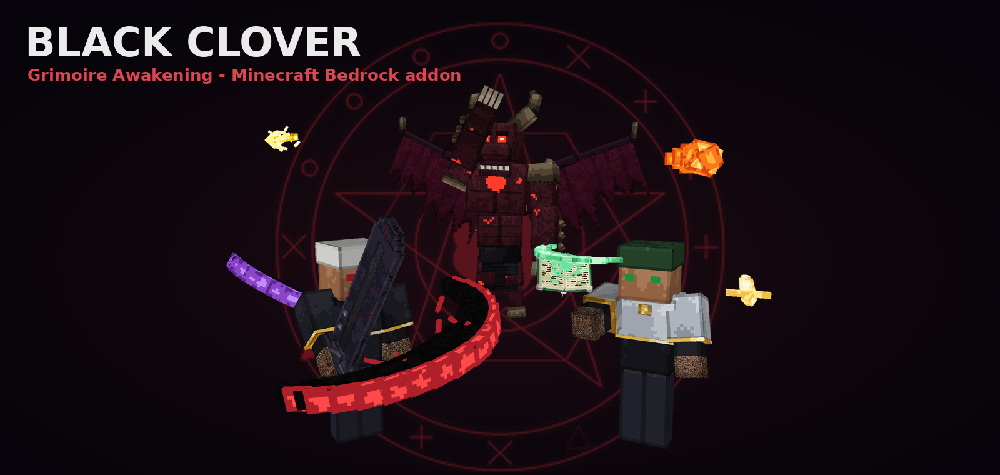

<!-- Generated by tools/docs.py from the game data (v1.2.0). Edit the generator, not this file. -->

# Black Clover: Grimoire Awakening - documentation

[Home](README.md) · [Getting started](getting-started.md) · [Magic](magic.md) · [Abyss Fruits](fruits.md) · [Companions](companions.md) · [Armour](armour.md) · [AI & simulation](ai-and-simulation.md) · [World events](world-events.md) · [The Untamed Kingdom](exploration.md) · [Dragonbound & Kingdoms](dragonbound.md) · [Mobs & bosses](mobs-and-bosses.md) · [Items & recipes](items-and-recipes.md) · [Progression](progression.md) · [Commands](commands.md) · [FAQ](faq.md) · [Development](development.md)

---

**Black Clover: Grimoire Awakening** is an unofficial Black Clover fan addon for Minecraft Bedrock Edition, now at **v1.2.0**.

## At a glance

| | |
|---|---|
| Grimoires | 40 attributes, 239 spells (39 awakened at level 15), the five-leaf Anti-Magic grimoire with 3 demon swords and Black Form |
| Abyss Fruits | 34 fruits, 136 abilities, 9 beast forms, the Will system |
| Creatures | 60 creatures, NPCs and bosses, including 19 bosses |
| Companions | a saved party of up to 4 knights plus 6 in reserve, each with a grimoire and an Abyss Fruit: personalities, specialisations, party tactics, combos, revives, mood, camps, trials, expeditions, sparring and rival squads |
| Effects | layered spell and fruit VFX (50 high-resolution particle effects), a rebuilt spell projectile, full-body cast animations |
| Armour | 9 sets (36 3D pieces) with bonuses for two and four pieces, the Magic Forge, 6 runes, reinforcement to +5, squad mantles, companions in armour |
| Items | 253 items and blocks, 65 recipes |
| AI & simulation | a tactical brain for spellcasters, enemy warbands (focus, flanking, calling for help, breaking), bosses that adapt, battles with tactics, morale and leaders, a world where four factions rise and fall |
| Adventure | daily missions and the Mission Board, 47 feats with titles, potions, elixirs, smoke bombs and spell scrolls, magic brooms, amulets, Magic Knight camps |
| Exploration | **the Untamed Kingdom** (v1.1.0): every 320-block region has its own name, realm, danger stars and traits; 17 kinds of landmark seeded across them (Mage Spires, Wyvern Roosts, procedural Catacombs, ruined hamlets...); random loot from Common to Mythic, 9 kinds of relic and rolled weapons; omens, wanderers, encounters, maps and journals |
| World | **a living world**: incidents happen out in the world, develop on their own, are reported by direction and tracked on your HUD, and become real when you arrive; Mana Waygates; an event director with scaling, objectives and a log; elite enemies with 17 traits; bandit hideouts, hive nests and cultist shrines; ships, outposts, wrecks, dungeons, the Bounty Board, a travelling merchant, the War Table |

## Pages

| Page | What is in it |
|---|---|
| [Getting started](getting-started.md) | install, your first hour, where to go next |
| [Magic](magic.md) | every attribute, altar odds, all 239 spells with numbers, anti-magic, techniques, how spells look |
| [Abyss Fruits](fruits.md) | all 34 fruits and 136 abilities with numbers, rules, Will |
| [Armour](armour.md) | every set and its bonuses, the Magic Forge, materials and where they drop, runes, reinforcement, mantles |
| [Companions](companions.md) | your squad: personalities, specialisations, tactics, combos, revives, mood, camp, talking, trials, the Squad Banner and expeditions, training, sparring, rival squads, bond, robes |
| [AI & simulation](ai-and-simulation.md) | the tactical brain, enemy and boss brains, battles (tactics, morale, leaders, bets, camera), the world simulation, knights |
| [World events](world-events.md) | the living world: incidents, how they develop and what happens if you ignore them; every event |
| [Dragonbound & Kingdoms](dragonbound.md) | hatch, raise and ride a wyvern; the Diamond, Spade and Heart kingdoms of the Marches; the Royal Capital |
| [The Untamed Kingdom](exploration.md) | regions, realms, danger and traits; the 15 kinds of landmark; random loot, relics and rolled weapons; Champions and Infernals; encounters; omens; wanderers; maps and journals; the Atlas |
| [Mobs & bosses](mobs-and-bosses.md) | every creature: health, attack, spawning, drops; all bosses and their attacks; factions; structures and lairs; elite enemies |
| [Items & recipes](items-and-recipes.md) | every recipe as a grid, every item id, potions and scrolls, both shops |
| [Progression](progression.md) | magic levels and mana formulas, ranks and stars, robes, bounties, daily missions, amulets, brooms, feats and titles |
| [Commands](commands.md) | every `/give`, `/summon` and `/scriptevent` |
| [FAQ](faq.md) | install problems, multiplayer, turning events off, known issues |
| [Development](development.md) | building from source, the code map, adding spells, releasing |

These pages are generated from the game data by `tools/docs.py`, so the numbers match the build. See also the [changelog](../CHANGELOG.md).
