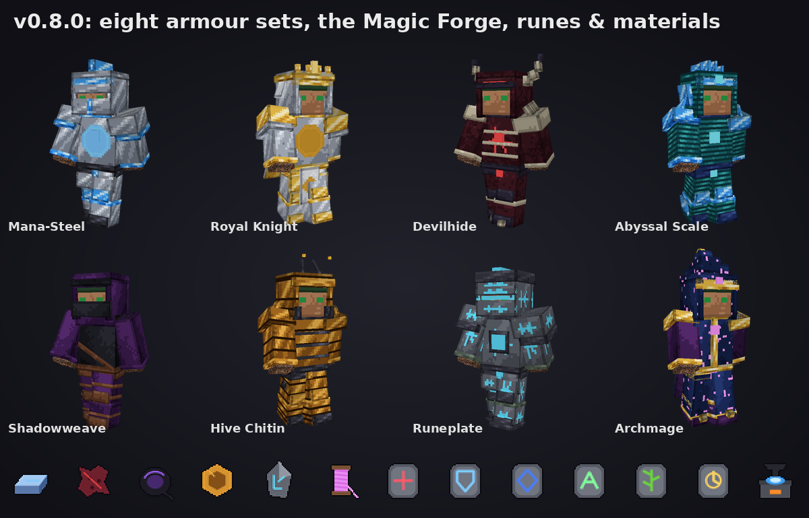

<!-- Generated by tools/docs.py from the game data (v0.8.0). Edit the generator, not this file. -->

# Armour & the Magic Forge

[Home](README.md) · [Getting started](getting-started.md) · [Magic](magic.md) · [Abyss Fruits](fruits.md) · [Companions](companions.md) · [Armour](armour.md) · [AI & simulation](ai-and-simulation.md) · [World events](world-events.md) · [Mobs & bosses](mobs-and-bosses.md) · [Items & recipes](items-and-recipes.md) · [Progression](progression.md) · [Commands](commands.md) · [FAQ](faq.md) · [Development](development.md)

---

**v0.8.0** adds eight armour sets of four pieces each. Every piece is a 3D model worn over your skin and robe. Wear **two** pieces of a set for its first bonus and **four** for the second. Mix sets freely: two pieces of one and two of another give both first bonuses.

## The Magic Forge

Craft a **Magic Forge** - `MAM / IBI / SSS` (mana crystals, an anvil, iron blocks, a blast furnace, stone bricks) - or use the one in any Magic Knight camp. Interact with it to:

* **Forge armour** - pick a set, then a piece. It takes the set's material, mana-steel ingots and mana crystals (creative players pay nothing).
* **Reinforce** the piece in your hand, up to **+5**. Each level cuts **all** damage you take by **1.5%** (a full +5 set: 30%).
* **Inscribe a rune** on the piece in your hand - one rune per piece; a new rune replaces the old one. Runes stack across your armour.
* **Sew a squad mantle** onto a chestplate: the squad robe is sewn on, and you keep the **robe's perk** while you wear the armour (sewing another mantle gives the old robe back).
* **Salvage** a piece for half its materials (and its mantle robe). Reinforcement and runes are lost.
* Open **the Armoury** - also in the Handbook - to see what you wear, your active bonuses, how much damage you shrug off, and every set.

Upgrades are written on the piece (its lore), so they stay with it - also when you hand it to a companion.

## The sets

| Set | Pieces (armour points) | Total | Material | Two pieces | Four pieces |
|---|---|---|---|---|---|
| **Mana-Steel** | Mana-Steel Helm (2) Mana-Steel Cuirass (6) Mana-Steel Greaves (5) Mana-Steel Boots (2) | 15 | Mana-Steel Ingot | +25 max mana | +25% mana regeneration, and spells cost 10% less mana |
| **Royal Knight** needs 8★ (Senior Magic Knight) | Royal Knight Helm (3) Royal Knight Plate (8) Royal Knight Tassets (6) Royal Knight Sabatons (3) | 20 | Mana-Steel Ingot | +10% spell power | Royal Aegis: falling below 30% health grants Absorption III and Resistance II for 6 s (once a minute); companions within 16 blocks fight 10% harder |
| **Devilhide** | Horned Devilhide Hood (3) Devilhide Jerkin (7) Devilhide Breeches (6) Devilhide Boots (3) | 19 | Devil Hide | Fire Resistance | Your spells heal you for 8% of the damage they deal, and hit 20% harder while you are below 30% health |
| **Abyssal Scale** | Abyssal Scale Crown (3) Abyssal Scale Mail (7) Abyssal Scale Leggings (5) Abyssal Scale Treads (3) | 18 | Leviathan Scale | Water Breathing, and Conduit Power while in water | The sea no longer drains Abyss Fruit users, and fruit powers recharge 15% faster |
| **Shadowweave** | Shadowweave Cowl (2) Shadowweave Vest (4) Shadowweave Trousers (3) Shadowweave Wraps (2) | 11 | Shadow Silk | Speed I | Evasion: a 20% chance to shrug off a melee blow; sneak still for 2 s to vanish, and your first blow from hiding deals double damage |
| **Hive Chitin** | Chitin Helm (2) Chitin Carapace (6) Chitin Leg Plates (5) Chitin Boots (2) | 15 | Chitin Plate | Immune to poison (the Hive's acid included) | Barbed: melee attackers take 3 damage and are poisoned; Regeneration I while you are below half health |
| **Runeplate** needs 15★ (First Class Senior Magic Knight) | Runeplate Greathelm (3) Runeplate Breastplate (8) Runeplate Cuisses (6) Runeplate Stompers (3) | 20 | Rune Shard | Explosions and falls hurt you 40% less | Resistance I; spells hurt you 20% less; when struck, a 15% chance of a rune pulse that hurls foes back (4 damage) |
| **Archmage** | Archmage Hood (2) Archmage Regalia (5) Archmage Skirts (4) Archmage Slippers (2) | 13 | Arcane Thread | Spell and fruit power cooldowns 10% shorter | +20% spell power and +40 max mana |

Durability: a chestplate has the set's full durability, a helmet 69%, leggings 94% and boots 81% (Mana-Steel 300, Royal Knight 460, Devilhide 400, Abyssal Scale 380, Shadowweave 240, Hive Chitin 340, Runeplate 560, Archmage 280). Repair pieces at an anvil with their material (or mana-steel ingots); all pieces are enchantable.

### What a piece costs

| Piece | Set material | Mana-steel ingots | Mana crystals | Mana-Steel and Royal sets: ingots |
|---|---|---|---|---|
| Helmet | 3 | 1 | 2 | 4 |
| Chestplate | 5 | 2 | 4 | 7 |
| Leggings | 4 | 2 | 3 | 6 |
| Boots | 2 | 1 | 2 | 3 |

The Mana-Steel and Royal Knight sets are made of ingots only (the last column); the Royal set also takes gold and diamonds: helmet 2 gold ingots and 1 diamond; chestplate 4 gold ingots and 2 diamonds; leggings 3 gold ingots and 2 diamonds; boots 2 gold ingots and 1 diamond.

## Materials

Materials drop only when you or your companions defeat the foe. Elite enemies have a 30% chance to carry one or two of any material.

| Material | Where it comes from | Used for |
|---|---|---|
| **Mana-Steel Ingot** `bc:mana_steel_ingot` | craft: an iron ingot and two mana crystals (any grid); the merchant sells 4 for 40 doubloons; camp and hideout chests | every set |
| **Devil Hide** `bc:devil_hide` | Devil (3-5), The Archdevil (6-10), Hellhound (40%), Imp (25%), Cultist (20%), Dark Disciple (15%), The Fallen Captain (3-6); cultist shrine chests | Devilhide |
| **Shadow Silk** `bc:shadow_silk` | Shadow Assassin (60%), Bandit Thief (35%), Bandit (8%), The Bandit King (4-6); bandit hideout vaults | Shadowweave |
| **Chitin Plate** `bc:chitin_plate` | Hive Drone (40%), Hive Egg (25%), The Hive Queen (6-10); hive nest chests | Hive Chitin |
| **Rune Shard** `bc:rune_shard` | Ancient Construct (50%), Dungeon Guardian (3-5), The Stone Colossus (6-10), Mana Wraith (25%); ancient dungeon chests; the merchant sells 2 for 55 doubloons | Runeplate and every rune |
| **Arcane Thread** `bc:arcane_thread` | Rogue Mage (35%), The Grimoire Devourer (6-10), The Frost Witch (2-4), The Ember Witch (2-4), The Soul Puppeteer (3-5); cultist shrine chests | Archmage |
| **Leviathan Scale** `bc:leviathan_scale` | the Abyssal Leviathan, the Storm Kraken, Raider Captain (50%), Phantom Raider (15%), Sea Raider (6%) | Abyssal Scale |

## Runes

Craft a rune from **two Rune Shards, a Mana Crystal** and its ingredient (any grid), then inscribe it at a Magic Forge.

| Rune | Effect (per rune; they stack across your armour) | Ingredient |
|---|---|---|
| **Rune of Vitality** `bc:rune_vitality` | +2 max health per rune | Glistering Melon Slice |
| **Rune of Warding** `bc:rune_warding` | spells hurt you 6% less per rune | Amethyst Shard |
| **Rune of Mana** `bc:rune_mana` | +15 max mana per rune | Lapis Block |
| **Rune of Swiftness** `bc:rune_swiftness` | Speed I with two runes, Speed II with four | Rabbit Foot |
| **Rune of Thorns** `bc:rune_thorns` | melee attackers take 1 damage per rune | Cactus |
| **Rune of Focus** `bc:rune_focus` | spell cooldowns 4% shorter per rune | Clock |

## Reinforcement

| Level | Mana-steel ingots | Mana crystals | Diamonds | Damage cut (this piece) | Four pieces at this level |
|---|---|---|---|---|---|
| +1 | 1 | 3 | – | 1.5% | 6% |
| +2 | 2 | 6 | – | 3.0% | 12% |
| +3 | 3 | 9 | – | 4.5% | 18% |
| +4 | 4 | 12 | 1 | 6.0% | 24% |
| +5 | 5 | 15 | 2 | 7.5% | 30% |

## How the protection adds up

* **Armour points** work like vanilla armour.
* **Reinforcement** cuts every hit. **Warding runes** (6% each, up to half) and **Runeplate (4)** (20%) cut magic - every spell, fruit power and magical attack. Magic is cut before it lands; other hits are cut by healing back the same share just after (so a single blow that would kill you still can). Together they never cut more than 70%.
* **Evasion** (Shadowweave) can shrug off a melee blow entirely; **Thorns** runes and **Chitin barbs** hurt melee attackers; the **Royal Aegis** catches you below 30% health once a minute.

## Companions in armour

Hand a companion a piece of armour (hold it and interact with them) and they wear it - you can see it on them. Its set bonuses, runes and reinforcement work for them too: power and cooldown bonuses in their spells, damage cuts, effects and reactions. Take pieces back from their profile (**Armour**); they come back with their upgrades. A player wearing four Royal Knight pieces makes companions within 16 blocks fight 10% harder.

## Feats

| Feat | Goal | Title |
|---|---|---|
| **Fully Armoured** | Wear all four pieces of an armour set. | "the Armoured" |
| **Armour Collector** | Wear four different full armour sets. | "the Collector" |
| **Forgemaster** | Forge 20 pieces of armour. | "Forgemaster" |
| **Master Smith** | Reinforce a piece of armour to +5. | "Master Smith" |
| **Runesmith** | Inscribe 8 runes. | "the Runesmith" |

See [Progression](progression.md#feats-and-titles-v075) for every feat.
