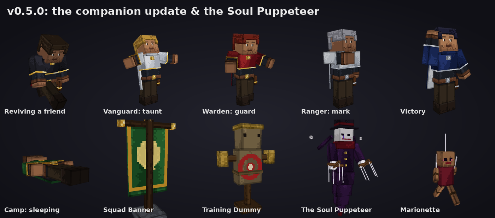

<!-- Generated by tools/docs.py from the game data (v0.6.0). Edit the generator, not this file. -->

# Companions

[Home](README.md) · [Getting started](getting-started.md) · [Magic](magic.md) · [Abyss Fruits](fruits.md) · [Companions](companions.md) · [AI & simulation](ai-and-simulation.md) · [World events](world-events.md) · [Mobs & bosses](mobs-and-bosses.md) · [Items & recipes](items-and-recipes.md) · [Progression](progression.md) · [Commands](commands.md) · [FAQ](faq.md) · [Development](development.md)

---

Up to **4 Magic Knights** travel with you as companions, and **6 more** wait in reserve at a Squad Banner. They are run by the [tactical brain](ai-and-simulation.md#the-tactical-brain-aijs) plus a squad layer that knows about you, each other and the fight (`src/scripts/living/companions.js`, `squad.js`, `camp.js`, `roster.js`, `rivals.js`).

## Getting companions

* Use a **Knight Contract** (emerald ×4, paper ×4, mana crystal) - a level-2 knight joins you.
* **Talk** to a wild Magic Knight and recruit it with a Knight Contract or 100 + 25 × level doubloons. It keeps its level.
* **Rescue** a wounded knight (world event): it joins you with 150 bond.
* Knights you hired before v0.2.0 join your party automatically.
* When your party is full, new recruits go to your **reserve** (up to 6).

## Your party is saved

* Each companion keeps its **name, magic, level, XP, kills, skill, courage, robe, bond, personality, specialisation, mood, amulet, trials and title** with your player - across sessions and deaths.
* A companion that falls **comes back to your side 60 seconds later** (real time) - or sooner, if someone [revives](#revives) it.
* **Dismiss** a companion to let it rest, **summon** it again any time. If it is left far behind (48+ blocks or another dimension) it catches up.

## The Companion Whistle

Craft: ` G / GMG / I` (gold ingot ×3, mana crystal, iron ingot), or buy it from the merchant.

| Use | Effect |
|---|---|
| **Hold** | a party frame on screen: each companion's health, mood and the party tactic |
| **Use** | open your party: each companion's level, health, bond and status; orders for everyone |
| **Sneak + use** looking at a foe | everyone attacks it for 20 s |
| **Sneak + use** looking at nothing | regroup: everyone back into formation at once |

| Party setting | Choices |
|---|---|
| Orders | everyone follow me / everyone hold here; per companion: follow, hold this position |
| Stance | **aggressive** (hunts any foe, helps with what you attack) · **defensive** (only foes within 10 blocks of you) · **passive** (no fighting) |
| Formation | **wedge** (two behind you, two further back) · **line** (beside you) · **circle** (around you) |
| Loot gathering | after a fight companions bring nearby drops to you |
| Tactic | **Balanced** (each companion fights its own way) · **Focus fire** (everyone attacks the same foe - your target, or the weakest enemy near you) · **Protect me** (stay within six blocks of you and only fight what comes close to you) · **Spread out** (keep apart from each other - best against big area attacks) · **Hit and run** (strike, then back off; ranged companions keep their distance) |
| Camp | make camp / break camp (see [Camp](#camp-and-the-night-watch)) |
| Training | practise on Training Dummies between fights |
| Sparring match | pick two companions to duel for practice |
| Per companion | summon / dismiss, hold / follow, talk, choose a specialisation, take back an amulet, rename, release |

## How companions think

* **Your fight is their fight:** they focus whatever you attack (for 10 s), and rush whoever is hurting you (for 6 s) - that comes first.
* **They look after you:** healers and buffers rate their spells much higher when you are below 40% health.
* **They do not get in the way:** a companion standing in your line of fire while you hold a grimoire or fruit power steps aside.
* **Formation:** out of combat they drift into their formation slots around you.
* **Downtime:** stand still for 30 s and they sit down; they gather loot, chat now and then, and react when a boss shows up or you are hurt.
* **Fighting:** spell choice, aiming, dodging and retreating come from the tactical brain; companions above level 10 cast 3% harder per level. Personality, specialisation, mood, tactics, combos and danger zones shape all of it - see below.

## A grimoire and a fruit

Every companion fights with **one grimoire and one Abyss Fruit** (v0.6.0). Companions recruited earlier get a fruit automatically; its glyph follows their name and their profile lists its moves.

* **Grimoire spells** grow with level: two at level 1, a third at 3, a fourth at 6, the new move at 12 and the awakened spell at 15 (the eleven classic grimoires - Wind to Mirror - use a fixed pair of spells until 12). A finished first trial opens the level-12 and awakened spells at once.
* **Fruit powers:** the first three moves from the start, the fourth from level **10** (or after their first trial). Like any fruit user they cannot use their fruit in water (the Shark Fruit excepted) or while anti-magic has sealed it.
* The tactical brain weighs every spell and every fruit power together and casts whatever fits the moment best.
* **Change their fruit:** hold any Abyss Fruit and talk to them - they eat it and its power replaces the old one.

## Personalities

Every companion has one (knights recruited before v0.5.0 get one too). It changes how they fight and what they say.

| Personality | Effect |
|---|---|
| **Brave** | First into every fight and never backs down. |
| **Cautious** | Keeps its distance and falls back early - rarely gets hurt. |
| **Loyal** | Sticks to your side and protects you before anything else. |
| **Hothead** | Charges the strongest foe and hits harder, but takes risks. |
| **Cheerful** | Lifts the whole party's spirits - morale recovers faster around them. |
| **Scholar** | Studies every fight: learns 25% faster and picks spells more cleverly. |

## Specialisations

At level **10** a companion can specialise (open its profile with the whistle). The skills join its spell list and the brain uses them when they fit the moment. **Mastery** arrives at level 20, or through the second personal trial. A **Companion Tome** lets them retrain.

| Specialisation | Role | What it does | Skills | Mastery |
|---|---|---|---|---|
| **Vanguard** | brawler | A front-line guardian: resistance in battle, taunts foes onto itself and shield-bashes them. | Taunt (pull every nearby foe and boss onto itself), Shield Bash (a stunning blow up close) | Bulwark: Resistance II while taunting, and Taunt reaches twice as far. |
| **Arcanist** | striker | A spell master: +15% spell power, cooldowns 15% shorter, and an arcane barrage. | Arcane Barrage (five homing darts of its own magic) | Spell Echo: a quarter of its spells are cast again at half power. |
| **Warden** | support | A protector: shields the party, cleanses curses, cuts down arrows aimed at you and revives fallen friends quickly. | Aegis (absorption and resistance for you and the party), Cleanse (removes poison, wither, slowness, blindness - and breaks mind control) | Sanctuary: Aegis also heals and cleanses. |
| **Ranger** | striker | A sharpshooter: fights from 10-16 blocks away, fires piercing volleys and marks targets for the party. | Volley (three piercing long-range bolts), Mark (the party deals +20% damage to the target) | Hawk Eye: marked foes take +35% damage, and Volley fires five bolts. |

* **Taunt**: every foe run by the tactical brain within 10 blocks (20 at mastery) turns on the Vanguard for 5 s; bosses add a big chunk of threat.
* **Aegis**: Absorption II (8 s) and Resistance I (6 s) for you and every companion within 14 blocks; the Warden casts it first when you are below 40%.
* **Cleanse**: removes poison, wither, slowness, weakness, blindness, nausea, mining fatigue, darkness, levitation and hunger - and cuts the Soul Puppeteer's strings.
* A **Warden** also destroys hostile spells and arrows within 4.5 blocks of you (every 3 s).
* A **Ranger** keeps 10 blocks away from the nearest foe; **Mark** lasts 8 s.

## Party tactics

| Tactic | Effect |
|---|---|
| **Balanced** | Each companion fights its own way. |
| **Focus fire** | Everyone attacks the same foe - your target, or the weakest enemy near you. |
| **Protect me** | Stay within six blocks of you and only fight what comes close to you. |
| **Spread out** | Keep apart from each other - best against big area attacks. |
| **Hit and run** | Strike, then back off; ranged companions keep their distance. |

## Fighting as a squad

* **Combos:** a foe held by a prison or a time stop takes **+25%** from the squad's spells - strikers go for bound foes, controllers look for fresh ones.
* **Marks:** a Ranger's mark adds **+20%** (+35% at mastery) to your squad's spells against that foe.
* **Danger:** boss warning circles, spell fields, meteor and rain targets are danger zones; companions step out of them (other NPCs do too, by skill).
* **Bodyguard:** a Vanguard stands between you and the closest foe; Loyal companions stay close.
* **Focus fire** picks the weakest foe within 16 blocks of you (bound or marked foes first) every second.

## Revives

A fallen companion leaves a **glowing clover** where it fell, for 60 seconds.

* **Sneak** beside it for 3 seconds and they get back up at half health.
* Otherwise a squadmate walks over and **kneels** there (only a Warden does this while foes are within 8 blocks of the spot); a Warden is twice as fast.
* A **Clover Leaf of Return** (emeralds, mana crystals, a golden apple) revives every fallen companion beside you at once.

## Mood

Each companion has **morale** and **weariness** (0-100). Morale rises with victories (+2 for its own kills, +15 for a boss), gifts and food (+5), talking (+5 once a day), a Cheerful friend in the party and rest; it drops when it falls (-15) or a friend falls (-5). Weariness builds by 2 every 10 s of fighting and falls with rest (8 per 10 s at camp, 3 while you sneak, 1.5 otherwise).

| State | When | Effect |
|---|---|---|
| **Inspired** | morale 80+ | +10% spell power, a little braver |
| **Shaken** | morale 30 or less | -10% spell power, retreats sooner |
| **Exhausted** | weariness 80+ | casts 30% slower |

Hand them **Field Rations** (bread, cooked beef, an apple, a Mana Cookie → 3): -50 weariness, +10 morale, 10 health.

## Camp and the night watch

Choose **Make camp** on the whistle (no monsters within 14 blocks): your companions sit in a circle around a fire, heal, lose weariness fast and tell stories. At night one of them (a Loyal or Cautious one if you have one) **keeps watch** - when something comes within 22 blocks it raises the alarm and everyone gets up. Camp ends when you walk 16 blocks away or a fight starts.

Out of camp, two companions sometimes **banter** with each other between fights.

## Talking

Open a companion's profile and choose **Talk**: ask how they feel (it depends on their mood and personality), about their hometown and dream, or for advice (gameplay tips). Once a day a talk gives +3 bond and +5 morale.

## Personal trials

At bond **Friend** a companion asks for help with a personal trial; at **Sworn Ally** a second one (twice the count). Kills by you or any party member count while they are with you (within 32 blocks).

| Trial | Kind | Count (first / second) |
|---|---|---|
| Help me prove myself - defeat 25 monsters with me at your side. | kill | 25 / 50 |
| Devils burned my village. Help me banish 10 of them. | kill | 10 / 20 |
| Sea raiders took everything my family had. Ten of them will answer for it. | kill | 10 / 20 |
| A rogue mage stole my master's grimoire. Help me bring four rogues to justice. | kill | 4 / 8 |
| I want to stand against a great foe with you. Any of the giants will do. | boss | 1 / 2 |
| Train with me: cast 60 spells while I watch your back. | cast | 60 / 120 |
| The restless dead frighten me. Help me face 20 of them. | kill | 20 / 40 |

* **First trial:** their grimoire **awakens** - every page opens, whatever their level - they earn a **title** (e.g. "the Unbroken"), +100 bond and full morale.
* **Second trial:** they master their specialisation (+150 bond).

## The Squad Banner

Craft: `WCW / WGW / ·S·` (green wool, a mana crystal, a gold ingot, a stick). Use it to:

* **Swap** knights between your party (4) and the reserve (6).
* **Train**: reserve knights gain 3 XP per real minute while they wait (collected at the banner, up to 200 minutes at a time).
* Send reserve knights on **expeditions** - they run in real time, even while you are offline:

| Expedition | Minutes | Min level | Danger | Spoils | XP |
|---|---|---|---|---|---|
| **Border Patrol** | 8 | 1 | ! | doubloon 10-25, mana crystal 1-3 (80%), bread 2-5 (60%) | 120 |
| **Merchant Escort** | 15 | 4 | !! | doubloon 30-60, mana cookie 2-4 (70%), treasure map 1-1 (25%) | 220 |
| **Ancient Ruins** | 20 | 6 | !! | ancient page 1-3 (90%), mana crystal 2-5 (80%), gold ingot 2-5 (60%), robe 1-1 (8%) | 320 |
| **Devil Hunt** | 30 | 10 | !!! | mana crystal 4-8, devil heart 1-1 (20%), ancient page 1-2 (60%), amulet 1-1 (15%) | 600 |
| **The Witch Woods** | 40 | 14 | !!!! | mana crystal 6-10, amulet 1-1 (35%), blaze rod 2-5 (60%), clover leaf 1-1 (15%) | 900 |
| **Dragon's Graveyard** | 60 | 18 | !!!!! | bone block 6-14, netherite scrap 1-2 (40%), clover charm 1-1 (8%), amulet 1-1 (40%), clover leaf 1-1 (25%) | 1400 |

Odds: 55% + 4% per level above the minimum, -4% per danger above 1, +10% for a fitting specialisation (e.g. an Arcanist in the ruins, a Vanguard or Warden on a devil hunt), +5% with mastery, ± mood (between 15% and 95%). A failed expedition still comes home - with half the spoils and XP, weary and shaken.

## Training and sparring

* **Training Dummy** (hay blocks, a target, sticks): place it anywhere; it shows DPS, the last hit and the total. Hitting it gives you 1 magic XP (up to 200 a day). With **Training** on, companions practise on dummies near you between fights: 2 XP a hit, up to 400 a day each. Sneak + use to pick it up.
* **Sparring match** (whistle): two companions duel with 60% damage; it ends when one drops below a third of its health (nobody can fall) or after 90 s. Winner +40 XP, loser +25 XP, both +4 bond.
* **Rival squads** (world event): another company's squad challenges your party. Their spells (and yours against them) do half damage and never kill; beaten rivals yield. Win for 40 + 20 per rival doubloons, +80 XP and +15 morale for every companion.

## Flying together

When you mount a broom, your companions summon brooms of their own (a Swift Broom from level 12) and fly in formation behind you. When you land, they land beside you.

## Gear

Hand a companion an **amulet** to wear (take it back from their profile): Battle Charm +12% power, Swift Sigil and Mana Heart shorter cooldowns (12% / 8%).

## Levels and health

Companions level up to **20** from kills (10 XP; 18 for this addon's creatures; 150 for a boss), training, sparring, rival matches and expeditions (Scholars learn 25% faster). More spells at levels 3, 6 and 15.

| Level | XP | Max health |
|---|---|---|
| 1 | 0 | 40 |
| 2 | 20 | 40 |
| 3 | 60 | 40 |
| 4 | 120 | 40 |
| 5 | 200 | 60 |
| 6 | 320 | 60 |
| 7 | 480 | 60 |
| 8 | 700 | 60 |
| 9 | 1000 | 60 |
| 10 | 1400 | 80 |
| 11 | 1900 | 80 |
| 12 | 2500 | 80 |
| 13 | 3200 | 80 |
| 14 | 4000 | 80 |
| 15 | 5000 | 100 |
| 16 | 6200 | 100 |
| 17 | 7600 | 100 |
| 18 | 9200 | 100 |
| 19 | 11000 | 100 |
| 20 | 13000 | 130 |

## Bond

Bond grows with time together (+1 a minute nearby), victories (+1 when you defeat a foe near them, +2 for their own kills), level-ups (+10) and **gifts** - hold the gift and talk to them:

| Gift | Bond |
|---|---|
| Mana Cookie | 40 |
| Cake | 30 |
| Golden apple | 25 |
| Hearty Roast | 20 |
| Mana crystal | 15 |
| Cooked beef / porkchop | 8 |
| Cooked chicken | 6 |
| Bread, cookie | 5 |

| Bond | Rank | Unlocks |
|---|---|---|
| 0 | **Stranger** | Follows and fights at your side. |
| 100 | **Comrade** | Keeps formation and casts 10% harder. |
| 300 | **Friend** | Mana Link: tops up your mana when it runs low (60s cooldown). |
| 700 | **Sworn Ally** | Guardian: shields you when you fall below 25% health (90s cooldown). |
| 1500 | **Soulbound** | Union Magic: unleash a combined spell together from the whistle (120s cooldown). |

* **Mana Link** restores 30 + 2 × level mana when yours drops below 20%.
* **Guardian** gives you Resistance II (6 s), Absorption II (10 s) and 4 health when you fall below 25%.
* **Union Magic** (from the whistle): your highest-level Soulbound companion casts its grimoire's ultimate spell at 2.2× power, with you.

## Robes

Hand a companion a squad robe (hold it and talk to them) to dress them in it. Their old robe item comes back to you.

| Robe | Companion perk |
|---|---|
| Black Bull | +25% spell power and Strength below 40% health |
| Golden Dawn | +10% spell power |
| Crimson Lion | +20% power for Flame and Magma knights (+5% otherwise) |
| Silver Eagle | +20% power above 75% health |
| Blue Rose | +15% power (including heals) |
| Green Mantis | cooldowns 20% shorter |
| Coral Peacock | cooldowns 10% shorter, +5% power |
| Purple Orca | +20% power for Water, Ice and Bubble knights; water breathing |
| Aqua Deer | +5% power; Speed out of combat |
